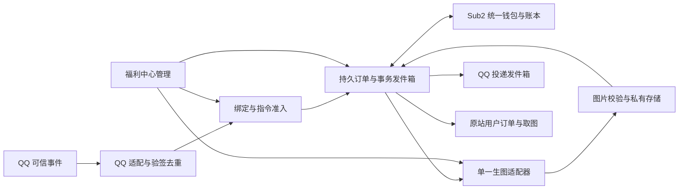
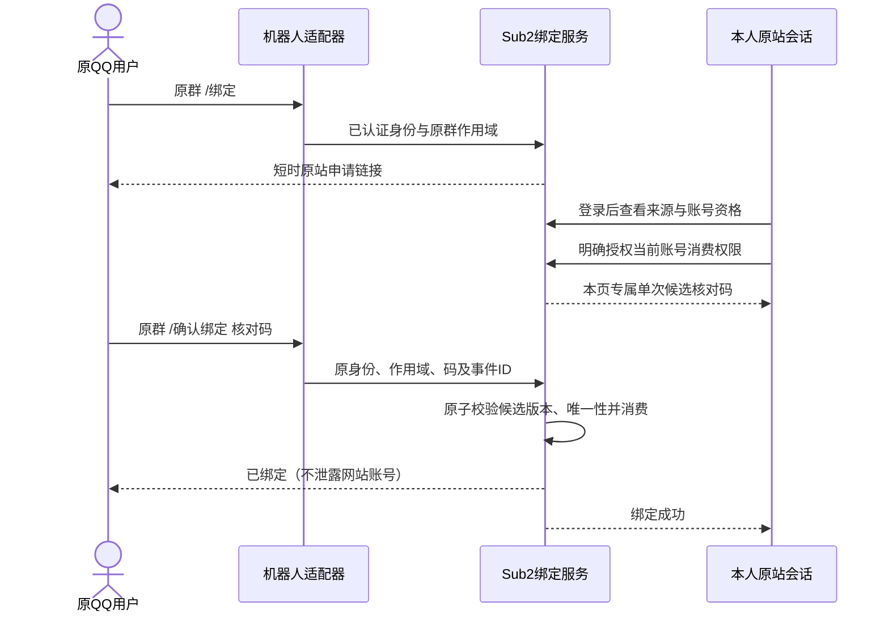
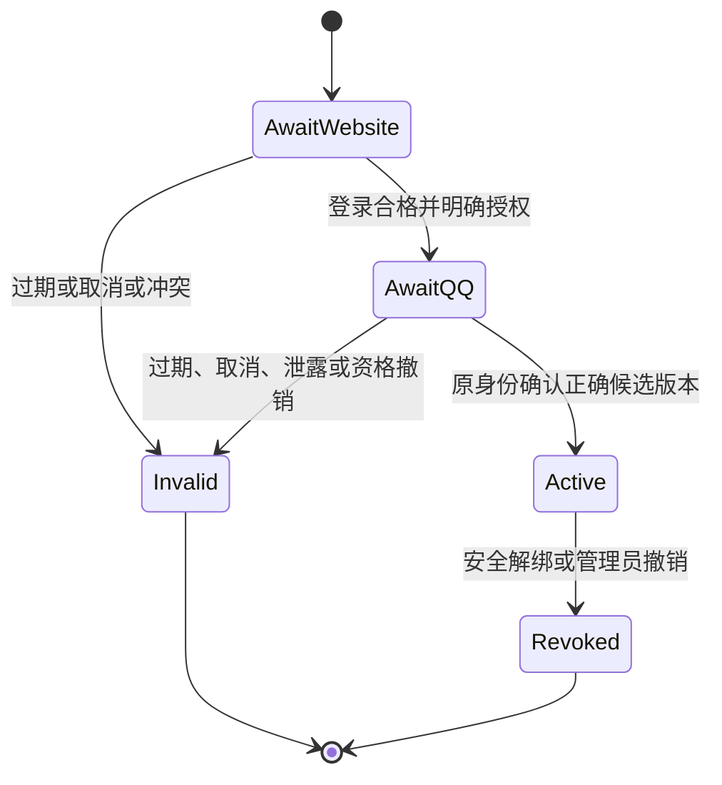
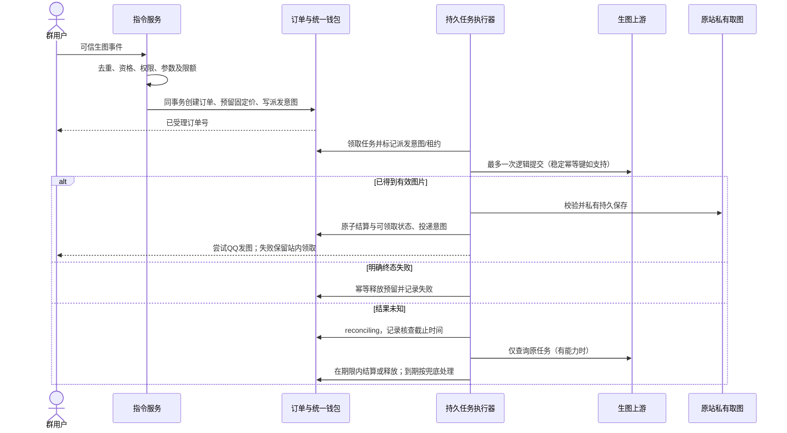
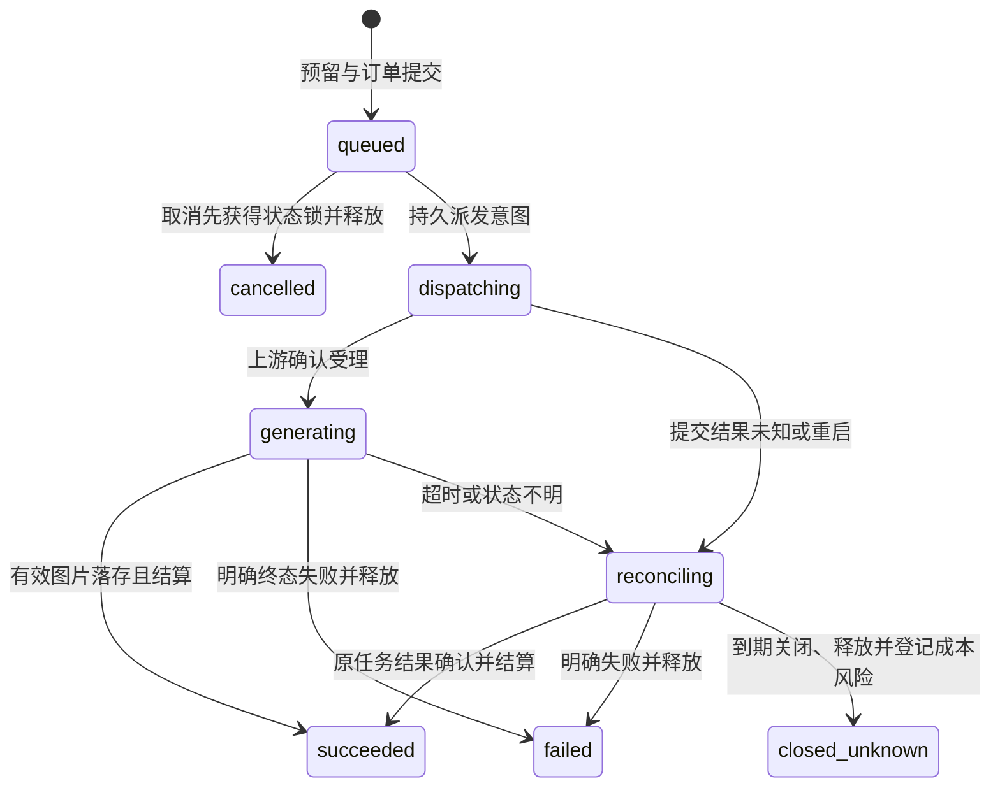

# Sub2 QQ 群生图设计草案

日期：2026-10-23（Asia/Shanghai）。状态：**已获开发授权并在独立工作树实施，未发布/部署**。唯一主设计文档；需求、页面、领域规则与验收条件均在此维护，不另复制 PRD。

以下开篇及第15节保留设计阶段范围；开发状态和实际验证见[实施记录](../../changes/2026-10-23-qq-image-generation.md)。设计阶段仅核对本地代码并编写文档，没有开发业务代码、迁移数据库、安装依赖、运行构建或应用测试，没有调用真实 QQ、生图、邮件、扣费接口，没有提交、推送、发布或部署。文中“必须”表示将来实现的设计约束，不表示现有系统已经具备。发布/生产事实以 [交接记录](../../HANDOFF.md) 为历史来源，本轮没有复核生产。

## 1. 需求来源、已确认与未决边界

用户原始目标：在 QQ 群发送指定指令生图；网站未注册、未完成邮箱与网站账号关联、未绑定或余额不足时不能生图；费用从网站账户余额扣除；管理员在现有福利中心配置生图 URL 和 Key。

用户已经同意按以下方向开始设计：绑定在现有 Sub2 网站内完成，机器人给出原网站链接，沿用原站登录、注册和账户余额；普通用户使用简洁绑定页，管理员在福利中心管理接口、价格和群。此同意是设计授权，不是对下面每个参数、收费边界或平台方案逐项批准。

| 标识 | 来源及状态 | 内容 |
| --- | --- | --- |
| C-01 | 用户明确目标 | 群指令触发生图，资格不足不调用上游；扣网站账户余额。 |
| C-02 | 已确认方向 | 原站登录后绑定，不另建网站；用户绑定页与管理员配置分离。 |
| C-03 | 已确认设计范围 | 先补齐逻辑、页面和异常，只做设计。 |
| S-01 | 首版建议 | 指定授权群；一个配置中的生图服务/模型；固定规格，每次一张，按张固定价。 |
| S-02 | 首版建议 | QQ 身份与网站账号双向确认；一个可验证平台身份最多一个网站余额账号；同一网站账号可管理多条分别确认的群作用域授权，不自动合并身份。见第 3 节。 |
| S-03 | 首版建议、业务待确认 | 图片安全落存并可由原订单所属网站用户领取时结算；QQ 投递失败只补发同一图片。 |
| S-04 | 首版建议、业务待确认 | 使用网站账户余额（users.balance）；不新增充值/赠送/兑换来源限制。月卡、福利余额和福利消费奖励的参与规则须单独确定，不沿用即视为同意。 |
| S-05 | 首版建议 | 先预留后派发，失败释放，未知结果限时核查，不自动重新 POST、不自动切换上游。 |
| U-01 | 上线前能力条件 | QQ 平台接入资质、真实身份作用域、消息接收/回复/媒体能力、域名规则。 |
| U-02 | 上线前业务决定 | 价格与货币单位、收费时点、未知结果兜底、留存及群内公开图片提示。 |
| U-03 | 上线前能力条件 | 可信邮箱验证语义、实际邮件投递，以及跨网站/API 的共享余额并发约束。 |

邮箱是用户识别和资格信息，绑定、订单归属和扣费必须使用不可变 `user_id`。禁止由 QQ 昵称、用户提交的 QQ 号、邮箱字符串或 `QQ号@qq.com` 推断账号归属。更换邮箱不会转移绑定或历史订单，邮箱资格发生变化会影响新单准入。

### 1.1 用户故事与首版范围

- **US-01 / R-01**：群用户通过机器人进入原站，登录本人账号、检查邮箱资格、明确授权，再由原 QQ 发起人确认；无需进入管理员后台。
- **US-02 / R-02**：已绑定用户在授权群生成一张图片，提交前可查固定价格；余额不足、账号不可用或超限时无上游调用、无扣款。
- **US-03 / R-03**：用户能区分排队、生成、核查、完成和失败；在网站查自己的订单/费用/取图，QQ 查询与补发须重新校验身份和归属。
- **US-04 / R-04**：用户可安全解绑；原网站账号继续持有其历史订单，换绑不搬走旧图片、费用或退款。
- **US-05 / R-05**：管理员在福利中心设置 QQ 接入、生图接口、固定价、群与限额，处理失败、核查、退款及审计。
- **US-06 / R-06**：重试、乱序回调、重启、配置变更和断网不造成重复生图、双扣、双退或无限冻结。

首版不包含多模型、多图及部分成功、图生图、任意多 QQ 共享账户授权产品、群独立价、优惠叠加、自动切换上游。设计中的取消使用站内订单按钮；群 `/取消` 可后置，避免扩充首版命令。

## 2. 架构取舍与职责

| 方案 | 取舍 | 结论 |
| --- | --- | --- |
| Sub2 负责身份/订单/账本，QQ 适配器只收发可信事件，生图适配器负责单一上游 | 需要新增领域流程，但可统一归属、资金和恢复 | 推荐；本文按此设计。适配器是否独立进程待实施时确定。 |
| 外部机器人直接持有用户 API Key，调用现有生图 HTTP 接口并另扣固定价 | 用户密钥暴露、账务双扣、超时状态分裂，难以保证权限撤销 | 不作为首版方案。 |
| 独立网站/独立余额系统 | 账号及资金需同步、增加用户操作 | 不符合已确认的原站绑定方向。 |



- QQ 适配层校验平台认证，规范化事件身份、消息 ID、群作用域和回复上下文；不接受正文中的身份字段作为权威值。
- 绑定服务负责一次性授权、版本、双端控制权证明和撤销，不扣费。
- 订单服务决定准入、报价快照、任务状态和恢复；钱包负责实际资金变更，两者同事务协调。
- 上游适配器只提交/查询/取回图片，不能自行再次扣用户余额。上游成本与用户售价分别记录。
- 投递层只发送已存在的结果；重发永远不创建生图任务。
- 网站提供正式领取能力与审计入口。QQ 消息并非可靠任务数据库。

## 3. QQ 平台能力与身份模型

### 3.1 平台选择已确认，真实权限待联调

用户在开发授权后明确选择官方 QQ 机器人；本文不默认安装 NapCat/OneBot，也不把兼容协议视为已获平台支持。若最终选择其他方案，须重新评估身份真实性、鉴权、账号运维与平台规则，不能仅替换 URL 后沿用官方信任前提。

协调聊天提供的官方资料入口：

- [消息收发概述](https://bot.q.qq.com/wiki/develop/api-v2/server-inter/message/overview.html)
- [群 @ 消息事件](https://bot.q.qq.com/wiki/develop/api-v2/autogen/event/group_at_message_create.html)
- [单聊消息事件](https://bot.q.qq.com/wiki/develop/api-v2/autogen/event/c2c_message_create.html)
- [全量群消息事件](https://bot.q.qq.com/wiki/develop/api-v2/autogen/event/group_message_create.html)

2026-10-23 协调聊天的研究子代理通过新版官方文档入口及链接读取正文，核对到群 @ 事件的 `author.member_openid` / `group_openid`、单聊事件的 `author.user_openid`；`union_openid` 虽标作跨应用统一身份但可为空，未找到跨群或群与单聊必然同 ID 的保证。群消息通常由 @ 触发，免 @ 全量消息须开通相应接收能力。消息概述列出的被动回复限制为群聊 **5 分钟、每条最多 5 次**，单聊 **60 分钟、每条最多 4 次**；新版也有主动消息能力及频控，不能宣称主动推送必然不支持。来源见上述官方事件和消息概述页；这些是文档事实，不是本项目机器人账号权限或身份映射已联调的证明。

[群发送接口](https://bot.q.qq.com/wiki/develop/api-v2/autogen/api/v2_groups_group_openid_messages.post.html) 列有不允许发送 URL、主动消息无权限等错误。因此绑定链接、QQ 内登录回跳、图片上传/发送、长任务取回均须上线前实测。此编写聊天直接打开官方页面未成功，平台正文事实来自上述协调研究补充；不把文档数值当作已获本账号配额。

**链接发送受限时的首版备用流程**：机器人返回短期申请编号，用户手动打开已知的原 Sub2 网站固定 `/qq/bind` 页面，登录后输入编号定位申请，检查发起上下文并明确授权；网站显示候选核对码，再由原 QQ 在原群/作用域确认。编号仅用于定位，不是授权或扣费凭证；同样限流、到期、候选锁定和双端确认，不要求机器人能发 URL、私聊或按钮。必须能独立辨认原站域名，不能引导用户到群里任意陌生网址输入密码。

### 3.2 身份不能靠显示名或字符串猜测

规范化身份至少包含 `platform`、`bot_app_id`、`subject_type`、`opaque_subject_id`、`scope_type`、`scope_id`；群资源另保存 `opaque_group_id`。数据库唯一性针对这个完整命名空间，不对裸 openid/QQ 号建跨平台唯一约束。

没有官方保证和实际证据时，群成员身份、跨群身份和单聊身份均不合并。`member_openid` 与 `user_openid` 名称相近或字符串相同都不是映射证据。若平台只提供群作用域身份，绑定仅在该作用域生效；不能宣传“一次绑定所有群可用”。同一网站账号可管理多条分别经双端确认的群作用域授权；每条可信身份只能指向一个网站余额账号。此安排不证明这些标识属于同一个实际 QQ，也不扩展为任意多 QQ 共享余额产品；跨群映射未验证时逐群授权、逐条撤销。

接收事件必须按选定平台协议验签/鉴权、检验时效及重放，并绑定预期 bot/app。事件去重键包含平台、app、事件/消息 ID 与其真实唯一范围；缺少可靠去重标识时不开放收费命令。平台重投返回已有处理结果，不再创建订单。展示昵称仅作提示，不作授权判断。

### 3.3 命令与回复约定

| 逻辑命令 | 行为 | 群内回复内容 |
| --- | --- | --- |
| `/生图帮助` | 显示可用命令、固定模型/规格、单价和公开性提示 | 不包含任何个人邮箱或余额。 |
| `/绑定` | 创建短时一次性申请，返回原站绑定链接 | “请仅绑定您本人刚发起的申请；登录后完成授权，再回 QQ 确认。” |
| `/确认绑定 <核对码>` | 完成双端证明 | 只回复成功/失败；不回显核对码、邮箱或候选账号。 |
| `/生图 <提示词>` | 全部准入通过后预留并入队 | 订单短号、排队状态和站内入口；短号不是访问凭证。 |
| `/任务 <订单号>` | 读取本人有权访问的订单摘要 | 状态及站内入口，不返回完整提示词、邮箱、详细余额。 |
| `/重发 <订单号>` | 在原群新回复上下文发送同一结果 | 不重新生成、不再扣款；记录投递尝试。 |

实际触发形式由适配器和已开通能力决定，例如 `@机器人 /生图 …`；文档中的斜杠表示逻辑命令。长任务可能超出被动回复窗口：保留网站领取，提示用户再次 `/任务` 或 `/重发` 建立新上下文。没有主动推送权限时不盲目后台循环发送。若可信私聊能力可用且已证明身份映射，可优先私聊绑定引导；否则保持群作用域流程，不能把单聊视为群身份的当然替代。

## 4. 原站用户页面

建议新增移动优先路由 `/qq/bind`、`/qq/orders` 与 `/qq/orders/:id`（路径为设计，不是已存在接口）。用户福利页增加“QQ 群生图”卡片，含“绑定管理 / 我的生图订单”；机器人可直达绑定页。复用原站外观、登录与注册，不给普通用户管理员权限。

绑定页文本布局：

```text
QQ 群生图绑定
申请来源：机器人名称 · 群名称/脱敏标识 · 发起时间
当前网站账号：仅本人登录页可见的账户标识
说明：绑定后，此 QQ 身份可通过群指令使用本网站账号余额生图。
      请只处理您本人刚在 QQ 发起的申请，不要替他人授权。
      群生图结果可能被群成员看到；价格以帮助页及订单报价为准。
资格检查：网站账号 / 邮箱要求 / 账号状态
[我确认这是本人申请，并授权此 QQ 使用本账户余额生图]
授权后：显示单次核对码及“回原群发送 @机器人 /确认绑定 <码>”
```

网站可展示自己的邮箱用于辨认账号；不在机器人消息、公开链接、日志或他人页面暴露。余额和费用明细只在本人已登录网站展示。授权页不默认勾选消费授权，不因打开链接或登录成功自动完成绑定。

| 页面状态 | 展示与动作 |
| --- | --- |
| 未登录 | “登录后绑定”；站内登录/注册，返回固定可信路径。 |
| 注册关闭/需邀请/需补邮箱 | 沿用原站准入；无法注册时说明原因，不绕过注册限制。 |
| 邮箱验证不满足 | “完成邮箱验证后继续”；申请到期则重新发起，不在群里收验证码。 |
| 待网站确认 | 显示来源、当前网站账号、消费授权和取消。 |
| 待 QQ 确认 | 当前登录页显示短时单次核对码、倒计时、原作用域；刷新不无限延长。 |
| 已成功 | 绑定来源/时间、解绑、订单入口；不自动发起生图。 |
| 已过期/已取消/失效 | 不复活旧申请，提示回 QQ 重新 `/绑定`。 |
| 冲突/已有绑定 | 不展示他人账号；提示“已有有效绑定，请先在原账号安全解绑或联系管理员核验”。 |
| 账号停用/申请上下文异常 | 终止本次流程，不提供一键跳过。 |
| 解绑确认 | 显示在途订单提示及需近期登录验证；解绑撤销 QQ 权限，不转移历史订单。 |

订单页独立展示生成、资金、投递三栏；金额含单位、单价、预留/已结算/已退金额，显示该订单快照，不读取当前价冒充旧价。排队订单可取消，已派发显示“请求已提交，不能保证取消；正在核查时不会再次生成”。生成可领取后提供鉴权图片预览/下载、保留截止时间；过期说明不重新扣费补图。错误文案给可操作的下一步和脱敏订单号，不输出上游响应原文/Key。

## 5. 双端绑定与解绑协议

### 5.1 绑定步骤与防诱导授权

1. 原 QQ 在授权群发送 `/绑定`。服务端从可信事件建立申请，记录身份命名空间、原群/作用域、申请 ID、revision 和截止时间；同一身份的新申请使旧未完成申请失效。已有有效绑定不允许通过新申请覆盖。
2. 返回仅指向配置中原站 HTTPS origin 的高熵随机票据链接。链接不含邮箱、密码、Key、真实身份明文或直接扣费授权。票据只存摘要；GET/预览扫描不消费、不授权，实际领取须登录后以防 CSRF 的 POST 完成。
3. 站内登录和注册沿用现有要求。服务端检查当前用户存在且 active、邮箱资格及绑定唯一约束；授权页显式说明这是授予 QQ 使用当前账号余额的权限。近期登录不足时要求重新认证。
4. 用户确认后，单事务锁定申请和候选 user_id，消耗初始领取票据，递增/固定候选版本，并产生只在当前登录页可见的短时单次核对码。申请有候选后不能被另一个网站账号覆盖；更换候选必须取消并从 QQ 重发。页面刷新可查询状态，但不无条件再签发码。
5. 用户将核对码发回原 QQ 群/经验证作用域。服务端同时匹配原 QQ、原群/作用域、app、申请 ID、revision、候选 user_id、核对码摘要、有效期和未消费状态。若选定平台支持等效可信私聊确认，须先证明其与原发起身份的映射。
6. 正确码由错误 QQ/作用域提交：视为该候选凭证泄露，候选失效，要求原发起人重新申请。任意错误码只返回通用错误并计入提交者限流，不能取消别人的申请。正确码成功消费后立即失效，旧码、旧版本和重复事件均不能改变归属。
7. 在同一事务重新检查账号资格及双方绑定唯一性，创建 active 绑定、记录授权版本/时间，标记申请完成。事务失败不能出现“申请已成功但绑定未建立”。网站轮询/刷新看到最终状态。

公开链接被他人领取仍不能直接绑定：他人网站登录最多锁定候选，必须持有原 QQ 控制权并准确确认候选码。页面的授权解释、原申请上下文和只在本人页出现的核对码共同防止误授权；不能把“双击两个确认按钮”描述成完全消除社会工程风险。链接遭抢占可由原 QQ 取消/重发，绑定提交时再次确认网站候选，禁止静默覆盖。

凭证页/交接响应使用 `no-store`、`no-referrer`；反向代理、分析埋点、错误监控不记录票据/码，完成交接后清理地址栏敏感参数。登录返回路径只允许服务端固定站内路由，不接受任意 `redirect_url`。站内所有写操作执行会话校验、CSRF 防护与权限检查。





### 5.2 解绑、封禁及换绑

网站本人经近期认证可解绑；管理员撤销须有管理权限、原因和审计，不能只凭群昵称将身份改给他人。失去原网站账号时走现有账号恢复/人工证据核验，群消息不构成管理员替用户认领账号的依据。

解绑递增 binding revision，撤销所有待确认申请和 QQ 访问权限。尚未派发订单与派发争抢时，用同一事务状态检查决定：取消先赢则释放且绝不派发；派发先赢则按在途订单继续核查/结算，不保证取消。派发前再次校验用户状态、绑定 revision 和邮箱资格。关闭入口的处理与撤销权限不同，见第 8 节。

已派发订单的付款人固定为原 `user_id`，不随解绑、换绑或邮箱变化改变。成功/失败按原协议结算或释放到原账号，QQ 自动投递和 `/任务`、`/重发` 在解绑后拒绝；网站原订单所属账号仍能领取。新绑定账号不能通过猜旧订单号取得原账号资料。QQ 查询、重发与自动投递均核对订单原 binding ID/revision；即使同一 QQ 重新绑定同一网站用户，也不恢复旧 revision 的 QQ 访问权限。发送执行器在最终领取投递任务时再次校验这些条件，解绑取消尚未领取的投递；解绑前已出站的 QQ 消息仍可能迟到，无法保证撤回，页面需说明。原账号删除或停用须保留账务归属。若已完成可领取交付后停用，不自动反转既有结算，退款按原单规则处理；若尚未达到可领取条件就停用/删除，则不得 capture，可在原核查期限内等待恢复资格，否则释放，不无限冻结。后台继续必要核查/释放/退款，不把资金转给新账号。

## 6. 生图准入、排队与状态

每个新生图事件依序检查：可信事件与去重 → 功能/群允许新单 → 有效绑定 → 网站用户存在且 active → 注册与邮箱资格 → 本功能权限 → 提示词/参数/内容规则 → 单价配置有效 → 用户/群/全局限流、并发、每日额度 → 原子预留足额可用余额。任一拒绝不调用上游。价格必须为有限、合法精度的正数；首版不默认支持零价，零价活动需另决策。

可用余额等于本项目 `users.balance`，不是 `balance - frozen_balance`；现有代码在预留时已经从 balance 扣出转入 frozen_balance。这里只说明当前语义，不表示现有全部路径已满足新约束。

订单入队事务固定：付款 user_id、binding ID/revision、发起身份/群、消息去重键、模型/规格/数量 1、单价/币种/精度、配置版本、上游/凭据版本引用、提示词摘要与必要私有原文、时限与保留策略快照。原子写订单、预留、账本和派发意图；事务成功前不发送上游请求。临时额度预占同样须并发安全，失败/取消按已定规则归还，终态累计消费不能双记。



图片仅 HTTP 200 不代表成功。须解码有效图片、校验实际类型/尺寸/字节限额，安全取回到本站受控私有存储，并能建立原用户领取权限。上游 URL 可能失效，不能仅把该 URL 存入订单就结算。文件已保存但数据库提交失败时，恢复程序按订单/内容摘要识别原文件继续完成，不重新生图；对象孤儿由有界清理处理。

三类状态分开，不用一个 `success` 同时表示生成、扣费和 QQ 发出：

| 维度 | 概念状态 | 约束 |
| --- | --- | --- |
| 生成/任务 | queued、dispatching、generating、reconciling、succeeded、failed、cancelled、closed_unknown | dispatching 已表示可能出站；只有 queued 的未派发任务可保证取消。succeeded 要有有效私有产物。 |
| 资金 | none、held、captured、released、refunded | held 只能捕获或释放一次；captured 的后续返款叫退款，不叫释放。首版仅全额退款，不做部分退款。 |
| 网站交付 | pending、available、expired、restricted | available 与捕获在同一可恢复完成流程确认；过期或权限封禁不等于生成失败。 |
| QQ 投递 | pending、sending、sent、retryable_failed、unknown、blocked、expired | QQ 回执未知不等于未发送；资金不得因投递重试变化。 |



执行器须持久租约/版本保护，崩溃和多实例竞争不能双派发。数据库与上游不存在分布式原子事务：进程在 POST 前后崩溃而上游不支持幂等/查询时，无法证明未提交，必须转核查或到期关闭，不承诺完全自动恢复。上游明确支持请求幂等且保证范围/有效期已验证时，恢复才可按适配契约重取同一任务；不得把普通 HTTP 重试当成幂等保证。

## 7. 钱包、计价与一次性结算

### 7.1 资金不变量

设当前可用余额为 B、冻结总额为 F、本订单固定价为 P；使用与网站一致的货币单位与精度，计算/比较采用精确金额表示，不引入浮点误差。现有数据库 numeric 与 Go float 接口的兼容需在实施设计中验证，不能直接复制 float 计算就宣称精确。

| 操作 | 本订单前置状态 | 原子资金变化 | 幂等与归属 |
| --- | --- | --- | --- |
| 预留 | none；B ≥ P；资格有效 | B := B − P；F := F + P | 每订单唯一 hold；重投相同参数返回原记录，冲突参数报错。 |
| 成功结算 | held；有效产物可领取；未到总截止且无关闭意图 | F := F − P；B 不再扣 | 每订单唯一 capture；原付款用户及价格快照不可变。 |
| 明确失败/取消/到期释放 | held | F := F − P；B := B + P | 每订单唯一 release；无本订单 hold 不得从总冻结池释放。 |
| 结算后全额退款 | captured 且未退款 | B := B + P；F 不变 | 唯一 refund，关联原 capture、原因、操作者；重试不双退。 |

订单行状态比较、该订单 hold 证明、钱包行及账本唯一约束须在同一事务中执行。capture 和 release 互斥；不能依靠“两个不同 request_id 都各自幂等”来防止先 capture 再 release。退款只允许 captured→refunded，released 不能再 refund，重复回调/管理员与恢复器竞争只能一个终态成功。资金操作失败必须保留 pending 恢复意图，页面不得提前声称已退款；修复账本不能直接编辑订单金额或清空 frozen_balance。

钱包中总冻结来自所有用途，不能把该用户 F 足够当作本订单已预留的证明。金额转移及账本不变量必须能逐订单对账。缓存只用于加速，权威事务成功后失效/更新缓存；缓存命中不能绕过数据库资金约束。

### 7.2 与网站/API 并发消费

QQ 必须使用现有 `users.balance` 钱包；最小集成边界为：在同一数据库事务按当前 B ≥ P 原子预留，把 P 从可用余额移入受本订单独占的 hold；网站/API 的普通扣费仍只操作可用余额，不能挪用该 hold；QQ 成功只消费自己的冻结，失败只归还自己的冻结；同步相关余额缓存失效，并对账订单、hold与账本。多个 QQ 群/实例都使用同一 user_id 和权威钱包，不能另建只保护 QQ 的余额计数器。QQ 指令自身不获得透支许可，QQ 预留不足必拒绝。

**现有 API 的后付/透支与 QQ 预付是不同承诺。** 当前普通用量结算余额不足仍可扣为负数，Redis在途估算也不保证严格拦截。仅新增上述 QQ 预留不能证明全站 B 永不为负：API 先提交后结算与 QQ 同时发生时，API 仍可能形成既有政策允许的欠款；QQ 预留若成功则已有独占资金，不得再扣 B。网站显示和帮助必须准确说明此边界，不能宣传全站严格无透支。

D-06 需确认是否接受“QQ 足额预付、全站其他入口既有透支规则保持”的最小方案（推荐，控制首版范围）。若要求所有入口累计消费都不超过账户资金，就必须协调 API 在途授信/估价、准入和最终结算，可能改变现有 API 行为；这属于另需批准的跨入口影响，不能以本次设计授权代替。无论选择哪种政策，都必须验证共享钱包并发、hold互斥和缓存一致，不能用只测QQ并发冒充全站策略验证。

### 7.3 售价、成本、福利与唯一扣费主体

- QQ 用户费用是下单快照 P；上游实际成本 C 单独记录，C 未知时保持未知，不能写 0。成本高于 P 不向用户追扣，成本低于 P 也不擅改固定价。
- 调价/换模型/换 URL 仅作用于新单；旧排队、在途、退款仍使用原配置与售价。报价有效性在受理事务确定，帮助页过时不影响订单快照可追溯性。
- 推荐复用本站下层生图执行能力，增加明确的“由 QQ 订单结算”内部上下文；不要为每用户悄悄创建 API Key，再同时走现有原生用量扣费和 QQ capture。若选用本站原生 HTTP 生图作为上游，只能由独立服务成本主体承担其账务，且需证明不会同时扣原用户；这种方案另做评估。
- 网站账户余额、福利余额与月卡额度是不同账户/权益。网站账户余额可能包含充值、赠送或兑换来源，本功能不新增来源限制。福利中心入口只表示管理位置，不把福利余额变成生图现金。
- 既有批量 capture 会触发福利消费累计，不能原样复用而无意加入 QQ 奖励。QQ 是否累计福利消费、退款如何冲回已发奖励、是否计入月卡统计，列为 D-04。未决期间该功能保持关闭，不能静默选择既有规则。

### 7.4 推荐收费边界（待业务确认 D-02）

当有效图片已安全持久保存，原订单所属网站账号可以领取，结算固定价。QQ 发送失败、机器人被禁言、回复窗口过期不自动退款；用户在网站领取或使用新指令补发原图。用户不实际点击下载不影响此边界。服务端故障造成承诺保留期内无法恢复图片时，按运营补偿流程全额退款并审计。

若业务选择“QQ 发送成功才收费”，须另设计投递结果未知、公共发出却无回执及用户反复重发的账务边界；本文不把两种标准混用。被封禁/违规结果的处置与用户费用须在 D-02/D-09 明确，未满足有效交付条件不自动 capture；上游已产生的成本另记。

## 8. 未知结果、异常与运营处理

订单在 hold 成功时固定排队截止（建议5分钟）及资金处理总截止（建议2小时），不得因重试、重启或换配置延长。queued 到期取消释放；捕获事务必须同时检查原用户可领取、未超过固定总截止、无关闭/释放意图，不能只检查 held。到期后即使释放事务失败仍显示 held，也只能恢复释放，迟到成功不可抢先 capture。数据库不可用造成的延迟需告警和审计，不宣称已经解冻。

建议同步等待上限 120 秒；超时转 reconciling 后，以原任务查询能力作指数退避（例如 15、30、60 秒，后续最多每 5 分钟），不再提交生成。首次可能出站起 30 分钟仍不明时告警管理员，自动冻结上限仍按 hold 时固定的2小时总截止；到期关闭为 closed_unknown 并释放，本单禁止后续自动扣款。时间值均是 D-05 待确认建议，实际不得超过上游任务/幂等有效期而假装仍可可靠查询。

无查询能力、查询凭据失效或响应持续不可信时更早转人工核查，也遵守总上限；管理员可凭明确任务/账本证据提前确认成功或失败，不能无证据点“已成功”制造扣费。常规流程不允许反复延期冻结；确需例外必须另获用户明确同意并记录新的期限。释放写入失败不等于已经解冻，后台必须高优先级告警并持续幂等恢复直到完成，登记未恢复时长和责任人。

| 情形 | 任务与资金 | 用户/管理员处理 |
| --- | --- | --- |
| 未绑定、账号不存在/停用、邮箱资格不足 | 拒绝，无预留、无上游 | 群里通用提示，具体原因在本人网站查看。 |
| 余额不足、超限、参数非法 | 拒绝，无上游 | 充值/等限流解除/修改提示词；不泄露详细余额。 |
| 重复事件、重复提交处理 | 返回原订单 | 不再次预留或生成；不同参数复用同幂等键报冲突。 |
| 入队事务失败、队列不可用 | 无提交则无预留；已提交则保留持久任务意图 | 恢复器重派持久任务；队列内存状态不是唯一凭据。 |
| 排队超时、用户取消 | CAS 仍 queued 则取消并释放 | 显示取消/释放完成；若已派发则提示不能保证取消。 |
| 出站前明确未发送失败 | 可在截止时间内重试调度，不能重复出站 | 只能有证据“未发送”时重派；否则核查。 |
| POST 超时、断连、5xx 或重启窗口 | 可能已受理，reconciling，保留预留至上限 | 查询原任务；不把 HTTP 错误一概当安全重试。 |
| 上游权威终态失败/拒绝 | failed，释放 | 记录脱敏原因；上游是否收费单独计成本。 |
| HTTP 200 空图、格式错、超限、危险图片 URL | 不满足交付，先核查原结果/重取同一产物 | 无法在核查期限内取得有效图则释放；不重新生图。 |
| 文件保存后、结算前崩溃 | 产物私有待发布，held | 按订单恢复一次结算与领取状态；不重复 POST。 |
| capture/release/refund 数据库失败 | 保持原资金状态及待处理意图 | 告警、退避重试、对账；不能先通知成功。 |
| QQ 拒发/窗口过期/禁言 | 生成可领取已结算，投递失败 | 保留网站领取；按能力等待新 `/重发` 上下文。 |
| QQ 发送回执未知 | 投递 unknown，资金不变 | 不无限自动重试；查询回执如支持，人工重发注明可能重复显示原图。 |
| 解绑或换绑 | 未派发取消释放；已派发按原订单结束 | 立即撤销旧 QQ 读/发权限；旧网站账号仍持有历史。 |
| 功能/群开关关闭 | 拒新单，已有授权队列正常排空 | 继续旧单结算、释放、网站领取及权限允许的补发；另有紧急“停止出站并取消未派发”操作，与派发使用同一状态锁；已可能出站的任务只能核查，不因停止而视作未受理。 |
| 群被移出/平台禁止发消息 | 不把平台禁令等同普通开关 | 旧单继续核查/退款/网站领取；该群投递 blocked，不绕过禁言或改投其他群。 |
| 密钥撤销/上游配置变更 | 在途仍指向原凭据版本 | 可用则原任务查询；不可用转人工并遵守解冻上限，绝不切新 URL 重生成。 |
| 已释放/退款后收到迟到成功 | 记录 late_result，资金终态不变 | 不追扣；建议可安全交付时免费给原用户，是否交付需 D-05 确认。 |
| 已结算后重复成功/失败回调 | 不反转终态或再扣/释放 | 异常差异进人工核查；返款只能走唯一退款动作。 |
| 图片过保留期 | 订单保留、产物过期 | 预先显示截止日期；按已确认条款，不暗中重生成或再次扣费。 |

重启恢复扫描订单/发件箱/资金待处理意图并对账：无派发证据的 queued 可继续；dispatching 可能已出站按未知处理；held 但无有效订单、资金终态与订单冲突均报警，不猜归属。管理员面板显示核查截止时间、最近证据和剩余冻结时长。

## 9. 管理员福利中心

建议在现有“统计 / 设置”旁增加“QQ 群生图”页签，独立使用 `qq_image_enabled`，不能因福利抽奖关闭而让绑定管理、旧订单取图与退款消失。用户直达页也不依赖 `welfare_enabled`；福利页只是一个入口，个人资料或账户导航仍可进入绑定管理。

```text
福利中心  [统计] [设置] [QQ 群生图]
QQ 群生图
  状态：关闭/仅接受旧单恢复/开放新单；待核查数、最久冻结时长
  接入：QQ机器人 | 生图服务（独立凭据）
  规则：授权群 | 模型规格和固定价 | 限流/额度/保留期限
  管理：绑定授权 | 订单与资金 | 异常核查 | 审计
```

| 分区 | 字段/操作 | 必须说明的边界 |
| --- | --- | --- |
| 功能及群 | 总开关、群启用、app/群作用域标识、群展示名、紧急停止出站 | 展示名不能作权限键；关闭新单与撤销发送权限分开。 |
| QQ 接入 | 平台类型、app/bot ID、服务端凭据/验签材料引用、事件入口和能力检查状态 | 生图 URL/Key 不替代 QQ 接入配置；不显示或记录完整密钥。 |
| 生图服务 | HTTPS base URL、接口类型、Key、模型、固定尺寸/格式、单张价、货币单位、超时 | 保存时做语法/安全校验，默认不发起收费请求；必须支持所选协议，不能假设所有 URL 都是 OpenAI 兼容接口。 |
| 频率和配额 | 用户/群/全局频率、并发、队列容量、每日张数/金额上限 | 规则版本化；限制须跨实例原子执行，不用进程内计数兜底放行。 |
| 绑定管理 | 原网站 user_id、脱敏邮箱、作用域、状态、授权时间、撤销原因 | 普通运营只看必要信息，敏感身份查看留审计；不得“输入邮箱强行换绑”。 |
| 订单/资金 | 三类状态、订单快照价、成本、hold/capture/release/refund记录、上游任务引用、截止时间 | 退款与释放分开按钮；只允许合法状态迁移，失败保留待处理意图。 |
| 核查 | 查询原任务、查看证据、核查成功/失败、到期释放状态、补发原图 | 不提供“重试生成”伪装成恢复；管理员补发须再次核验目标群/绑定。 |
| 审计 | 操作者、时间、对象、前后版本、原因、结果、关联订单/请求 | 敏感值脱敏，不记录 Key、绑定票据、验证码及全量私密提示词。 |

密钥以服务端密钥管理/加密存储保存，页面仅显示末尾标识和已配置状态。空输入表示不修改，清除/撤销为独立明确动作，读接口不返回原值。解密权限与普通运营权限分离；数据库备份及日志不成为明文 Key 仓库。凭据版本只保存引用，不能为恢复在订单里复制明文旧 Key。

轮换时新单使用新版本，旧单查询须有原凭据版本访问策略和到期时间；需要保留旧凭据时采用受控加密存储及审计，到在途核查结束后撤销。若出于泄露必须立即撤销，接受旧任务可能无法查询并进入人工/限时释放，不能保证“无损轮换”。同理机器人凭据撤销会阻止旧投递，但不阻止网站领取及资金恢复。

“检查配置”只做本地校验；“验证连接”只有在上游明确提供无扣费接口时才调用，并说明检查了什么。实际“试生成一张”是单独动作，必须显示成本承担账号/预算、单价和结果归属，经明确授权后才允许；不得默认扣某个真实用户的钱。本轮不执行这些检查。

## 10. 概念数据与接口职责

以下为领域合同，不是 SQL、Ent 迁移或最终 HTTP 定稿；新增表及迁移在后续实施方案单独审阅。

| 实体 | 最小信息/唯一约束 |
| --- | --- |
| QQBindingRequest | 随机申请ID/可输入短编号、可信原身份/原群、ticket摘要、候选user_id、revision、核对码摘要、期限、消费状态、授权文本版本；候选锁定后不可替换。 |
| QQBindingGrant | platform/app/场景/群/主体组成的可信作用域身份、user_id、revision、active/revoked、授权/撤销时间；同一身份最多一个active账号，用户可管理多条分别授权的群作用域记录。 |
| QQImageConfigVersion | 不可变模型/规格/固定价/金额单位、URL与协议版本、凭据引用、时限/留存/限额；管理修改生成新版本，订单引用旧版。 |
| QQImageOrder | 随机公开订单号、原付款user_id、grant/revision、原群和事件键、私有提示词/摘要、价格与配置快照、上游幂等键/任务ID、三类状态、核查期限、乐观锁版本、产物引用。 |
| WalletHold / LedgerEntry | 每订单预留、唯一capture或release、原capture对应唯一全额refund、金额/单位/原用户、指纹与审计；终态互斥，不只依赖聚合frozen_balance。 |
| ProviderAttempt | 逻辑提交ID、可能出站时间、所用凭据版本、上游引用、状态证据、成本及其是否已知；敏感响应摘要化。 |
| ImageArtifact | 私有存储键、订单/原user_id、类型/大小/尺寸/内容摘要、可领取及过期时间；不能以URL拥有者替代订单归属。 |
| Outbox / DeliveryAttempt | 派发/投递意图、租约、重试/回执状态、原QQ上下文和期限、发送去重键；不能重新生成。 |
| AdminAudit | 有权限的操作者、动作、原因、证据引用、对象版本和结果；账务审计随事务或可靠发件箱持久化。 |

| 接口类别 | 调用者与权限 | 职责 |
| --- | --- | --- |
| QQ 事件入口 | 仅经过平台鉴权的事件 | 验签、去重、解析指令、使用可信身份；webhook快速确认与任务异步处理分开。 |
| 绑定申请查询/领取/授权 | 原站登录会话；部分公开页只说明流程 | 链接或短编号定位申请；编号建议随机12位字母数字且10分钟失效；申请详情最小化、限流；POST授权和CSRF；不靠查询参数指定user_id。 |
| 绑定状态/解绑 | 当前网站用户+近期认证 | 仅查看/撤销自己的授权；取消未完成意图、增加revision。 |
| 订单列表/详情/取消/取图 | 网站当前用户 | 服务端按原owner过滤；无权限与不存在使用等价外部响应，防枚举。 |
| QQ任务查询/补发 | 可信QQ、原群、当前有效grant | 必须匹配订单原owner、原grant及其revision；不得仅验证“现在绑了某个用户”。 |
| 管理配置/核查/退款/下载 | 管理员角色及最小操作权限 | 读写配置版本、只走合法状态迁移；下载同样做权限与审计，不公开直链。 |
| 上游回调（如果采用） | 签名/鉴权的上游 | 校验任务归属和版本，验签+去重，不接收回调自报价格或付款人。无可信回调则使用认证查询。 |

多条群作用域授权可以指向同一网站账号，但每条都要完成双端授权；它解决同一人跨群不可证明同ID的问题，不承诺自动识别多个实际 QQ 号，也不首发推广“任意多 QQ 共用钱包”。若运营确需限制到一个实际 QQ 账号，必须先具备平台可靠映射证据，无法靠网站声明或昵称执行该约束。

### 10.1 图片、链接及内容边界

- 普通网站取图必须登录并校验原订单所属用户，管理员下载校验专门权限。随机订单号、公开链接、存储路径或签名 URL 均不能单独替代用户归属检查。解绑不改变网站 owner。
- 群里直接发送生成图片会让群成员看到、保存；这是群公开交付，需在帮助和授权页清楚告知，并由 D-09 确认。系统无法撤回他人已经保存的群图片。任何情况下都不附邮箱、余额或网站会话票据。
- 首选通过可信 QQ 媒体上传能力发送二进制/媒体ID。若平台只能拉取 URL，须先确认专用媒体拉取通道的可用鉴权、短时效/最小暴露及是否满足保密要求；不能无说明把私有原图改成长期匿名公开URL。无法满足时首版只发不带取图凭证的站内订单入口，由登录用户领取，群发图能力单列为未满足，不冒充已支持。
- 生图 base URL 仅管理员可配，启用 HTTPS、目标白名单/网络出口约束；禁止内网、回环、链路本地、云元数据地址，校验解析结果和每次重定向，限制端口。上游返回的图片 URL 同样按目标白名单、DNS变化及重定向校验，凭据不得转发到其他主机。是否需要特定私有服务由运维另做显式例外，不能默认开通全部内网。
- 限制响应字节、解码尺寸、类型与抓取超时；检查实际内容而非只信扩展名/Content-Type。提示词长度/内容规则在入队前检查，上游安全拒绝归为失败；图片展示做内容与安全校验，私密提示词不进入公开群错误消息。
- 产物到期清理与订单账务留存分开；清理需按订单锁/引用确认，不删除其他任务使用的文件。保留期、备份、用户删除请求与审计留存策略上线前确定。

## 11. 当前代码的复用点与限制

本轮只读基线是主目录 `main`，HEAD `c9a9209ea`，包含既有未提交修改；不是对已发布 `76ff7c88a` 或生产的复验。下面行号是核对时定位，函数和文件名为稳定查找入口。

| 位置与当前事实 | 可复用与必须补足的差异 |
| --- | --- |
| [WelfareSettingsView.vue](../../../frontend/src/views/admin/WelfareSettingsView.vue) 第9/49行有statistics/settings；[admin/welfare.ts](../../../frontend/src/api/admin/welfare.ts) 第44行只保存enabled | 复用管理员页结构与权限，新增独立QQ分区/配置合同，不能把Key塞进现有enabled请求。 |
| [WelfareView.vue](../../../frontend/src/views/user/WelfareView.vue) 第101行起为用户福利区；[router/index.ts](../../../frontend/src/router/index.ts) 第930行有welfare开关拦截 | 可放入口，但QQ直达、历史订单和解绑须独立开关；避免关闭福利后失去取图能力。 |
| [LoginView.vue](../../../frontend/src/views/auth/LoginView.vue) 第611行支持redirect；[RegisterView.vue](../../../frontend/src/views/auth/RegisterView.vue) 第1084/1122行未完整携带返回目标，直接注册后去dashboard | 复用登录，补跨注册/邮箱验证的受保护申请意图恢复，不假设注册自动回绑定页。 |
| [user.go](../../../backend/ent/schema/user.go) 第40/49/52/57行有email、balance、frozen_balance、status及身份关系 | balance/frozen为decimal(20,8)而Go接口使用float；字段存在不代表QQ资格或严格预付费已实现。 |
| [auth_identity.go](../../../backend/ent/schema/auth_identity.go) 第17/64/93行有provider白名单、verified_at和身份唯一索引，当前无QQ | QQ生图授权可先用独立业务grant，不要求QQ登录；不能直接写一个qq provider绕过前后端/SQL约束。 |
| [auth_email_binding.go](../../../backend/internal/service/auth_email_binding.go) 第40/68/205行核验邮箱码、密码并事务更新/撤销会话 | 可复用邮箱所有权证明流程；QQ资格须绑定当前具体邮箱和可信验证来源，变更邮箱需重新判定。 |
| [109历史迁移](../../../backend/migrations/109_auth_identity_compat_backfill.sql) 第14行回填verified_at；[auth_service.go](../../../backend/internal/service/auth_service.go) 第1061/1170行有身份补写 | 非空email、Bound=true或旧verified_at均不必然证明邮箱实际验证过；需明确可信验证语义与旧用户补验策略。 |
| [openai_images.go](../../../backend/internal/handler/openai_images.go) 第136/408行有准入、在途预占和RecordUsage；[openai_gateway_usage.go](../../../backend/internal/service/openai_gateway_usage.go) 第522行进入结算 | 可参考生图执行/图片解析，不能作为“无计费纯转发”再让QQ层重复扣款。 |
| [batch_image_billing_hold.go](../../../backend/internal/service/batch_image_billing_hold.go) 第30/58行构造/执行预留命令 | 有hold/capture/release语义，但强依赖APIKeyID，不能要求普通QQ用户自行创建或交出Key。 |
| [usage_billing_repo.go](../../../backend/internal/repository/usage_billing_repo.go) 第69/251/283/310/345行有幂等声明、普通扣费、冻结/捕获/释放 | 复用事务模式；balance已扣出冻结，普通扣费允许透支；三种request_id不是同一冻结单互斥终态。 |
| [billing_inflight_reservation.go](../../../backend/internal/service/billing_inflight_reservation.go) 第248/319行与[独立余额缓存](../../../backend/internal/service/billing_cache_service.go) 第342行 | Redis估算与故障放行不能替代QQ数据库原子预留；预留/释放需覆盖相关余额缓存失效。 |
| [batch_image_public.go](../../../backend/internal/service/batch_image_public.go) 第353行提交错误释放，第1095行只调用认证缓存失效；[batch_image_billing_recovery.go](../../../backend/internal/service/batch_image_billing_recovery.go) 第39行恢复无上游任务名的旧单 | 可借鉴后台任务组织，不能照抄为QQ未知结果恢复；本地缺少taskID不等于上游未受理。 |
| [welfare_spend_repo.go](../../../backend/internal/repository/welfare_spend_repo.go) 第114行累计消费；[welfare_service.go](../../../backend/internal/service/welfare_service.go) 第243行兑换 | 福利钱包与users.balance不同；批量capture会关联消费奖励，QQ是否参与须先决定。 |

在新增本设计前，对 `backend`、`frontend/src`、`docs/superpowers/specs` 当前可搜索文本检索 `NapCat`、`OneBot`、`qq_group`、`QQ群`、`QQ机器人` 及独立 QQ 词，未找到 QQ 群机器人集成实现或相关设计；其他命中为邮箱示例、域名、浏览器UA等。结论不覆盖所有工作树、外部机器人服务或生产部署。

[2026-10-23邮件排查交接](../../HANDOFF.md) 记录当时 SMTP host/username/from 为空、密码设置不存在、注册邮箱验证码开关 false。那是另一轮历史只读排查，本轮没有查询生产、发邮件或验证实际投递。若决定 QQ 要求已验证邮箱，可信验证状态及 SMTP 可投递是上线依赖；不能从“页面提示已发送”推断收信成功。

## 12. 可审阅的运营参数建议

以下全部是建议初值，不是用户逐项批准或平台承诺；更改应版本化。每个开关默认关闭，完成第14节后才可开放。

| 参数 | 建议初值 | 依据/边界 |
| --- | --- | --- |
| 绑定申请 | 10分钟；每身份最多1个未完成申请 | 同时限制IP/身份/群请求速率，防刷号与公开链接枚举。 |
| 候选核对码 | 8位随机字母数字，5分钟且不超过申请期限，单次使用 | 只存摘要，正确码与原身份匹配；每提交者5分钟最多5次失败，另有全局保护。 |
| 网站近期认证 | 15分钟以内，解绑/授权均检查 | 需按现有会话/MFA能力实现，不能要求用户在群里发密码。 |
| 用户并发/频率 | 全部作用域合计1个在途订单、10秒1条生图命令 | 多群不能绕过同一付款user_id限额。 |
| 群/全局并发 | 每群2个、全局5个，按服务容量调整 | queued等待不占上游并发，但占队列/金额预留额度。 |
| 队列 | 全局50个、等待最多5分钟 | 满队列先拒绝；超时仍未派发则取消释放。 |
| 每日限额 | 每user_id 20张；管理员另设金额上限且启用前必填 | Asia/Shanghai自然日；预留+已结算共同约束，失败释放配额；明确成功跨日按受理日归属。 |
| 提示词/图片 | 提示词最多2000字符；图片抓取最多20MiB、解码最多2000万像素 | 实际尺寸/格式由单一模型固定，限制不能低于合法预期输出。 |
| 单次等待/核查 | 120秒/30分钟提醒/2小时释放上限 | 不等于上游可取消；未知成本由运营登记。 |
| QQ重发 | 每订单60秒最多1次；后台自动重试仅在确定未发送且仍有回复额度时 | 回执未知不盲目重试，平台限流优先。 |
| 图片保留 | 7天，从可领取时间起计 | 站内展示明确截止时间；到期清理不抹除账本。 |
| 订单/审计保留 | 建议180天，按实际业务/隐私要求确认 | 提示词、图片、资金摘要分别最小化留存；不宣称满足任何未评估法规。 |
| 价格 | 管理员必须显式设置正价、单位和8位以内精度 | 不猜上游成本，不默认一个金额；帮助页、下单和网站订单一致。 |

排队、核查与额度用服务端权威时间，不信任客户端时间。每日限额记录所属业务日，延迟回调不能搬到另一日重复计数。群数量或平台限额更严格时以严格者为准。

## 13. 后续实施验收场景（本轮未执行）

以下是将来可自动化/联调的验收合同，不是本轮测试结果。

| ID | 场景 | 必须可观察的结果 |
| --- | --- | --- |
| A-01 | 未登录/未注册/缺邮箱进入绑定 | 返回原站流程；无绑定、无费用；注册后能恢复申请或明确过期。 |
| A-02 | 旧verified_at非空但缺少可信验证证据 | 按已批准邮箱策略补验，不误判已验证；SMTP失败不显示已验证。 |
| A-03 | 公开链接被旁观者打开/扫描 | GET不消费；仅登录授权锁候选；原QQ未确认不生效。 |
| A-04 | 候选被锁后另一网站账号打开同链接 | 不替换候选；取消/重发使旧版本失效。 |
| A-05 | 正确核对码被错误QQ/群提交 | 候选失效；错误随机码只限流提交者，不取消他人申请。 |
| A-06 | 重复确认、乱序确认、已过期码 | 仅一次成功，不覆盖绑定；旧版本无效。 |
| A-07 | 跨app/跨群/单聊有相同或不同openid | 未经映射证明不自动合并；分别授权可到同一user_id，分别撤销。 |
| A-08 | 链接发送被平台拒绝 | 用户手动访问固定原站页+短编号仍可完成同等双端确认。 |
| A-09 | 用户不存在/停用/解绑/邮箱资格撤销 | 新单拒绝且上游调用计数为0；无预留。 |
| A-10 | 余额小于P/恰好P，两个并发QQ单 | 不足拒绝；恰好只允许一个hold，可用/冻结变化精确。 |
| A-11 | 网站/API扣费与QQ预留并发 | 同一users钱包；只允许符合D-06选定政策的结果，QQ不挪用别人hold、不重复扣费；明确验证API既有透支行为是否保持。 |
| A-12 | 同消息重复、相同幂等键不同请求 | 同消息只一单一次逻辑生成；冲突报错不复用错误参数。 |
| A-13 | 调价/换模型/换Key后旧队列执行 | 使用旧订单价与原配置版本；凭据不可用转核查，不切上游。 |
| A-14 | 预留成功回包丢失、capture与release并发 | 恢复只一次账本变更；终态互斥，无法借聚合冻结双退。 |
| A-15 | 原生生图执行路径接入 | 一次用户实际扣款；单独记录上游成本，无RecordUsage+QQ capture双扣。 |
| A-16 | 排队取消与执行器派发竞争 | 只有一方成功；取消成功则上游0次并释放，否则按在途处理。 |
| A-17 | POST超时/5xx/重启且上游实际已受理 | 转reconciling，只查原任务，不再次POST或切上游。 |
| A-18 | 无查询能力/旧凭据撤销/到期释放失败 | 显示能力限制，30分钟提醒，hold起算总上限进入释放恢复；到期仍held也不得被迟到结果capture。 |
| A-19 | HTTP200但空图/错误类型/危险URL | 不按成功收费，安全拒绝抓取危险目标，核查到期释放。 |
| A-20 | 图片落存后结算前重启 | 同产物可恢复，最多一次capture；不重新生成。 |
| A-21 | 已释放/退款后迟到成功或重复失败回调 | 不追扣、不双退；迟到结果按已批准免费交付/丢弃政策处理。 |
| A-22 | QQ窗口过期/发图失败/发送回执未知 | 网站可领取，资金不因重发变化；新指令只取原图，可能重复显示的投递风险可见。 |
| A-23 | 解绑与投递领取竞争、同账号重绑后访问旧单 | 仅解绑前已出站可能迟到；旧grant/revision的QQ权限不恢复；原网站账号仍有权限。 |
| A-24 | 关入口/关福利/群移除 | 新单关闭；旧资金恢复及网站领取继续；平台禁止发送时不绕过。 |
| A-25 | 普通用户读他人图/管理员无下载权限 | 服务端拒绝，随机链接/订单号无法绕过；审计无Key、票据、码。 |
| A-26 | SSRF重定向、DNS变化、超大图片 | 每跳限制有效，无内网访问或无界响应；结果不算交付。 |
| A-27 | 退款与恢复器重复处理/事务失败 | 首版仅一次全额退款，失败保留意图；不先报告已退。 |
| A-28 | 福利累计、退款冲回与月卡参与 | 严格按D-04选定政策，不能因复用capture函数偷加福利规则。 |
| A-29 | 多群并发/跨午夜终态/失败释放 | user_id合并限额和业务日稳定；配额不重复增加/归还。 |
| A-30 | 7天过期/保留期内存储损坏 | 过期前有截止提示；承诺期内无法恢复按补偿规则处理。 |
| A-31 | 后台连接检查/真实试生成 | 无成本检查与收费动作明确分开；真实试生成有授权的成本归属。 |
| A-32 | 派发后、可领取前停用账号 | 不capture；期限内恢复才可交付，否则释放；已交付后停用不自动反转结算。 |

实施验证分层：领域状态与并发数据库约束、前端会话及意图恢复、模拟上游故障、QQ沙箱/获准真实能力联调、最终计费与恢复核对。只有用户另行授权实施后才编写或执行相应测试，本文不包含测试执行命令。

## 14. 上线前业务决定与能力门槛

| ID | 需决定/验证 | 建议及不满足时的处理 |
| --- | --- | --- |
| D-01 | QQ官方已确认；账号资质、app权限、身份映射与绑定基数 | 作用域身份分别授权，可到同一网站user_id；未证明跨群/单聊映射前不自动合并。 |
| D-02 | 用户收费时点、价格/币种、内容拒绝和补偿边界 | 推荐本站可领取即结算，QQ失败不自动退款；价格必须明确。 |
| D-03 | 邮箱要求到底是“已绑定”还是“可信验证” | 推荐可信验证，旧兼容字段不可直接视作证明；确认旧用户补验政策，并验证邮件实际可达。 |
| D-04 | 月卡/福利余额/福利消费奖励与退款冲回 | 建议账户余额付款，其他权益单独明确；不改变既有规则，不凭入口名称推断。 |
| D-05 | 未知任务截止、释放/补偿、迟到结果和成本承担 | 推荐2小时上限释放，不追扣，安全迟到结果可免费交付；上游成本由运营承担。 |
| D-06 | QQ严格预付费承诺与既有API透支政策 | 推荐最小集成确保QQ足额原子预留、hold隔离、唯一扣费、缓存一致和对账；若要求全站不透支需另批准跨入口变更，见7.2。 |
| D-07 | OpenAI兼容Images已确认；实际协议能力、成本证据 | 验证真实能力和时限；没有查询不承诺自动恢复，运营接受未知成本政策后才能启用。 |
| D-08 | QQ消息与链接/媒体能力 | 实测@触发、窗口/次数、主动推送权限、链接许可、QQ内登录回跳、图片大小/上传与拉取；不能发送链接时使用短编号备用流程。 |
| D-09 | 群图片公开性、内容政策、产物/提示词/审计留存 | 确认提示及期限；媒体私有性无法满足时明确仅网站领取，不能假装群发图已验收。 |
| D-10 | 默认限额、告警人员、恢复职责、凭据轮换 | 配置明确责任人与核查时限；旧凭据撤销后人工边界可接受。 |

开放收费的必要证据：绑定双端与跨作用域隔离通过；邮箱资格可判定且必要邮件可送达；共享钱包策略批准并通过并发/互斥验收；唯一扣费主体明确；未知任务有可执行截止和责任人；网站私有领取可靠；QQ链接/备用流程和实际消息能力已验证。未完成时保持功能关闭。

## 15. 设计阶段文档核对与自审（历史记录）

本轮实际范围为本地只读代码/规范核对、官方研究补充合并、文档差异/链接/可跟踪性检查及独立设计审阅；未运行任何应用测试。当前设计不是技术实现完成证明，也不是价格、权益或平台上线批准。

自审关注与落点：双扣（7.3唯一结算主体）、双退（7.1同一hold互斥终态）、换绑与原owner（5.2/10）、跨群身份（3.2/10）、公开链接与诱导授权（4/5.1）、未知结果及迟到回调（6/8）、图片归属与公开群交付（10.1）、旧Key/配置/调价（7.3/9）。尚未决定的事项集中在第14节，均未写成用户已同意。

2026-10-23 实际文档检查：23处本地链接目标全部存在；7组代码围栏配对，其中5个Mermaid图块；32项未来验收场景与10项上线决定编号齐全。完成独立设计审阅并修正冻结总期限、到期后禁止capture、解绑投递竞态和交付前账号停用边界；图仅作文本结构检查，未渲染。`git diff --check` 无差异格式错误；新主文档未被忽略，可纳入Git，目前仍为未暂存新文件。没有运行应用测试或构建。

本轮改动仅为本主文档、`.gitignore`的一条精确允许规则和`docs/HANDOFF.md`末尾“设计草案、未实施”简短记录。对既有11份tracked WIP核对：9份未触及文件SHA256不变，另2份重叠文件剔除本轮追加后与开始时SHA256一致；未修改既有未跟踪文件。本轮未创建临时脚本/测试目录，无需清理其他任务文件；未暂存、提交或推送。


## 16. 开发阶段已确定的实现选择

用户已分别确认官方QQ机器人、OpenAI兼容Images。首版采用原站可领取即结算、网站账户USD余额、QQ不参与福利/月卡、2小时未知上限释放与7天图片保留、可信当前邮箱补验；这些是本轮开发采用的实现选择，真实价格/模型/凭据/平台权限由管理员配置联调。固定资金单位不提供切换币种或汇率。上游成本单独持久标为null/unknown，不推断为零。同步协议没有标准任务查询或幂等重放保证。新增精确image_hosts允许表支持CDN图片，默认只API同主机。其余运营/上线约束见第14节和实施记录，不将实现当作真实联调通过。
