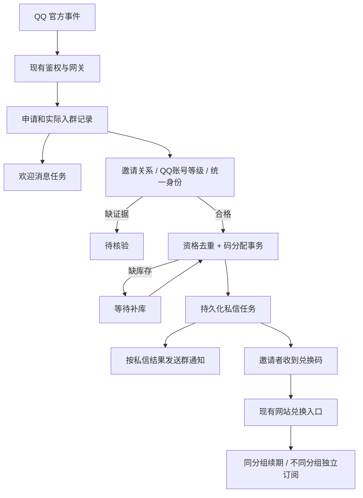

# QQ 邀请入群赠送月卡：需求与开发设计

- 日期：2026-11-10（Asia/Shanghai）
- 状态：下文第1–11节保留初版官方接口方案。用户随后批准改用NapCat专用福利账号并完整开发；当前实现与验证以[最新变更说明](../docs/changes/2026-11-10-napcat-invite.md)为准，未发布/部署/真实扫码。
- 项目：Sub2API，主目录 `E:/sub2二次开发项目`；调研 HEAD：`c4105ca17ea07aa17f50cfe305c0af85a1c1460b`。主目录存在其他未提交修改，本轮保留。
- 读者：产品负责人、后端/前端开发、后续接手的 AI。
- 当前批准方案：NapCat普通福利QQ账号承担等级查询、入群与通知；Sub2统一活动/码库后台及扫码重登；同服务器独立Docker服务。原官方机器人保持现有职责。以下初版中的官方OpenID桥接、双花括号模板及建议接口不作为最终实现契约。

## 1. 已确认需求与范围

### 1.1 用户明确要求

1. 有新用户实际进入活动群时，机器人发送邀请奖励宣传消息；具体文字由管理员在后台配置。
2. 用户邀请一名合格新人入群后，群内真实 @ 邀请者并祝贺获得一张月卡，引导查看机器人私信。
3. 机器人私信邀请者一张月卡兑换码，管理员在后台专门维护这些奖励码。
4. 被邀请人的 **QQ 账号等级必须严格大于 10，即至少 11 级**；10 级及以下不奖励，不给邀请者发送奖励私信。
5. 同一邀请者可邀请多个不同新人，每个合格新人奖励一张。
6. 多张同类月卡兑换时叠加时长；不同类月卡分别获得对应订阅，不把时长加到其他类别。
7. 本轮已补充确认：兑换码是 **Sub2 自己的订阅兑换码**。
8. 本轮已补充确认：**同一被邀请人在整场活动覆盖的所有群中只产生一次奖励**，退群重进或跨活动群加入不能重复奖励。

### 1.2 设计建议，尚非用户确认的运营规则

| 项目 | 第一版建议 |
| --- | --- |
| 发奖时点 | 确认实际入群、邀请关系、等级、统一身份后立即发奖，不新增留群若干天要求 |
| 月卡时长 | 每张 30 天，与现有默认值一致；上线前由管理员确认，按码的有效天数执行 |
| 奖励类别 | 一场活动选择一个奖励订阅分组；不同活动可发不同类别，不随机抽取混合码池 |
| 获奖上限 | 不设邀请者累计上限；库存不足只排队，不丢弃资格 |
| 新人定义 | 活动启动基线中不存在、启动后首次确认入群的自然人账号；历史入群且早已退群者无法在无历史证据时断言“从未入群” |
| 同一新人多次邀请 | 只采信能唯一关联到实际入群的官方邀请记录；有冲突时待核验，不按管理员审批人或最后一条消息猜测 |
| 兑换归属 | 第一版沿用现有持码登录兑换机制；码发送给邀请者，但不新增“必须先授权网站余额生图”的要求。若要限制仅邀请者本人兑换，需增加独立、无消费授权的账号身份绑定，属于扩展范围 |
| 退出处理 | 已发奖后退出不自动收回月卡；再次入群不重发 |
| 月卡暂停 | 保持现有订阅码兑换语义：兑换可能恢复 suspended 订阅。若暂停代表惩罚，应在上线前另行确定是否禁止此类用户兑换 |

### 1.3 本期不包含

- 不给新人发卡，不自动替邀请者兑换，不扣 API 余额，不产生付款订单。
- 不把月卡奖励折成福利钱包余额，不给赠卡额外计算付费抽奖次数或现金推广返利。
- 原始范围排除NapCat；后续用户已明确批准引入，详见顶部最新实现说明。现有官方机器人仍保留。
- 不增加自动审批入群、踢人或强制留群功能。
- 不改智商检测、Cloudflare 菜单/截图业务及其数据库。
- 同一活动暂停、重启、改名或改文案不更换活动 ID、不重置去重记录。用户确认的是单场活动一次；新建独立活动是否允许历史参与者再次获奖，属于待明确的跨活动运营政策，本期不实现永久去重。

## 2. 工作区核查与建议放置位置

### 2.1 项目归属

当前聊天工作区 `E:/sub2二次开发工作区` 下是多个历史开发/审查目录。QQ 生图和网站绑定已合入 **`E:/sub2二次开发项目` 主仓**；旧 `.worktrees/qq-image-generation-20261023` 不是新任务默认入口。

一个用户可见机器人由两套程序处理：Sub2 负责绑定、余额、生图及模板后台；独立 ai-check 仓的 Cloudflare Worker 负责菜单和智商截图。本功能涉及本站码库、月卡和后台，应由 Sub2 统一负责发奖及通知。两个服务不能同时处理入群奖励。

### 2.2 后台位置

建议导航：

```text
管理后台
└─ 福利中心
   └─ QQ 机器人（现名称为“QQ 群生图”，建议将容器名称改为 QQ 机器人）
      ├─ 连接与群配置
      ├─ 回复模板
      ├─ 邀请奖励
      │  ├─ 活动设置
      │  ├─ 奖励码库
      │  └─ 邀请/发放记录
      ├─ 生图订单
      ├─ 生图授权
      └─ 审计记录
```

只调整管理容器标题，不改变用户端生图和绑定页面名称。“邀请码”在 Sub2 已有注册含义，新入口应明确叫“邀请奖励/月卡码库”。

- 活动规则与码库存放在“邀请奖励”。
- 欢迎、奖励成功、私信、补领提示继续使用统一“回复模板”能力，邀请奖励页提供跳转和只读预览。
- 通用“兑换码管理”仍保留，邀请库存码显示来源、活动和占用状态；不能从通用入口绕过库存保护。

### 2.3 方案比较

| 方案 | 优点 | 代价 | 建议 |
| --- | --- | --- | --- |
| Sub2 新增邀请奖励模块，共用现有 QQ 接入与兑换体系 | 用户、码库、订阅、审计在同一数据库，易于保证发奖唯一性 | 需要扩展官方事件、主动消息和身份核验 | **推荐** |
| 在 Cloudflare 菜单 Worker 发奖，再远程调用 Sub2 | 能利用已有另一条 QQ 连接 | 跨服务重试、权限、重复发奖与联调更复杂 | 不选 |
| 新建独立 QQ 机器人/服务及新码库 | 分离部署 | 重复建设身份、后台、库存，增加维护负担 | 本期不选 |

## 3. 可行性与必须先验证的能力

以下平台资料于 2026-11-10 直接读取腾讯官方现网文档。文档有接口不等于目标机器人已获权限，本轮未登录机器人控制台或验证真实群。

| 能力 | 已查到的事实 | 开发结论 |
| --- | --- | --- |
| 新成员入群 | 官方有 GROUP_MEMBER_ADD，订阅位 GROUP_MEMBER_EVENT = 1<<24；事件含群、成员、时间 | 可设计接入，需在目标 App 验证 |
| 识别邀请者 | GROUP_JOIN_REQUEST 的 apply_source=invited 时有 invited_by；机器人须是群管理员 | 记录申请，再与实际入群关联；申请本身不能发奖 |
| 入群事件自身的邀请者 | 官方当前 GROUP_MEMBER_ADD 表没有邀请者字段 | 不把 op_member_openid、审批管理员或昵称当邀请人 |
| QQ 账号等级 | 已核查的申请、入群、成员信息和成员列表接口均未提供账号等级 | **完整自动化的首要待解决项**；不能假定存在 get_qq_level |
| 跨群统一身份 | 申请/成员接口可能提供 union_openid，但注明“如有” | 必须验证稳定性、覆盖率和命名空间，缺失时不能保证全活动去重 |
| 获取成员与建立启动基线 | 成员列表/成员信息接口标注内邀接入、白名单权限 | 先确认权限；无法建立可信基线时，不自动认定历史成员为新人 |
| 主动群消息 | 官方支持主动发送；成员入群事件不在发送接口列出的可回复 event_id 类型中 | 独立主动消息方法，不伪造 msg_id/event_id |
| 主动私信 | 官方提供 /v2/users/{user_openid}/messages；有无好友、拒收、无权限、限流等错误 | 可以实现尝试投递与补领，但不能保证任何群成员都直接可达 |
| 群 @ 与私信身份 | 当前源码没有成员 @ 构造、C2C 身份映射 | 验证真实 @ 格式，确认 member_openid、invited_by 与 user_openid 的对应规则 |

等级来源必须满足：是 **QQ 账号等级**，来源可信，身份能对应当前被邀请人，有查询时间或证据时间；不得用群活跃等级、角色、昵称、账号年龄或用户自填数字代替。等级未知与等级低是两种状态：未知进入待核验，低于 11 明确不合格。

**上线门槛：** 邀请证据、账号等级、跨群身份三项任一未验证，完整自动发奖不得开启。可先完成后台、库存、事件记录和欢迎消息；若要以管理员人工核验作为过渡，需用户另行选择，并明确其不等同于“自动检测 QQ 等级”的验收结果。不能悄悄放宽 >10 规则。

官方依据：

- [群成员加入](https://bot.q.qq.com/wiki/develop/api-v2/autogen/event/group_member_add.html)
- [用户申请加群事件](https://bot.q.qq.com/wiki/develop/api-v2/autogen/event/group_join_request.html)
- [入群申请列表](https://bot.q.qq.com/wiki/develop/api-v2/autogen/api/v2_groups_group_openid_join_request_list.get.html)
- [获取群成员列表](https://bot.q.qq.com/wiki/develop/api-v2/autogen/api/v2_groups_group_openid_members.get.html)
- [获取群成员信息](https://bot.q.qq.com/wiki/develop/api-v2/autogen/api/v2_groups_group_openid_members_member_openid.get.html)
- [消息收发概述](https://bot.q.qq.com/wiki/develop/api-v2/server-inter/message/overview.html)
- [发送群消息](https://bot.q.qq.com/wiki/develop/api-v2/autogen/api/v2_groups_group_openid_messages.post.html)
- [发送单聊消息](https://bot.q.qq.com/wiki/develop/api-v2/autogen/api/v2_users_user_openid_messages.post.html)

上述资料未证明完整等级查询能力；不将“没有在这些页面找到”扩大为平台永远不支持。官方单聊文档的时效描述也有不一致，本功能优先使用独立主动消息路径，实际错误以平台回执为准。

## 4. 产品流程与功能要求

### 4.1 正常流程

1. 管理员选择群、活动时间、奖励套餐，填写宣传和通知文案，补充专用码库。
2. 启用前完成权限、统一身份、等级来源、库存与成员基线检查。
3. 机器人收到邀请申请，保存邀请者与被邀请人证据。
4. 确认新人实际入群后，发送欢迎/邀请奖励宣传。这个动作不依赖新人等级或是否有邀请者。
5. 自动核验：活动有效、群匹配、确为新人、邀请归属唯一、账号等级 >=11、统一身份可用、此前未获奖励。
6. 按实际入群时有效的活动规则版本判定；一个数据库事务确定获奖资格、占用一张对应月卡码并写入私信发送任务。
7. 先尝试私信。平台确认发送成功后，群内真实 @ 邀请者，发送“恭喜获得月卡一张，前往机器人私信查看兑换码”。
8. 用户自行登录 Sub2 的 /redeem 页面兑换。发出兑换码与开通订阅是两个独立时点。
9. 私信失败时保留同一奖励和码，群内改用真实状态的提示，例如“已获得月卡，请添加机器人好友并私信领取”。不谎称私信已经送达。

消息顺序建议先私信后群通知，避免用户看到“查看私信”却实际无法送达；不改变用户要求的两种通知结果。

### 4.2 编号需求

| 编号 | 要求 |
| --- | --- |
| FR-01 | 每个活动群的实际入群事件触发一次宣传，重复推送不重复发送任务；机器人自身和已证实的机器人账号不触发 |
| FR-02 | 管理员可编辑、预览、发布、回滚模板；文案改变不得改变资格规则或发码数量 |
| FR-03 | 只有可信邀请来源且实际入群才计奖；主动申请但无邀请证据只欢迎不发奖 |
| FR-04 | 等级 >=11 合格；<=10 不合格；无数据、超时或来源异常进入待核验且不发码、不发获奖私信 |
| FR-05 | 以“活动+应用命名空间+统一被邀请人身份”保证至多一次奖励，不能只按群维度去重 |
| FR-06 | 邀请者邀请不同合格新人可以累计多张，每人一张；奖励类型来自实际入群时有效的活动配置快照 |
| FR-07 | 只使用管理员明确加入邀请池的码，不自动消耗普通销售/其他业务的码 |
| FR-08 | 支持批量添加本站已有未使用月卡码，以及从当前月卡码列表勾选加入；一键生成并加入是便利入口 |
| FR-09 | 入池校验码存在、subscription 类型、匹配 group_id、月卡天数正确、未过期/未使用/未作废/未占用，批量预检给出逐行原因 |
| FR-10 | 库存不足进入 waiting_stock；补充库存后按资格时间顺序自动补发；不因缺货取消已确认资格 |
| FR-11 | 发码成功表示码已分配给该奖励，不等于码已兑换；未使用且已发出的码不得回收给其他获奖者 |
| FR-12 | 私信重试、人工补发、服务重启都重用原码；不得重新领取另一张码 |
| FR-13 | 群内禁止出现兑换码；私信包含码、套餐名称、天数、本站兑换地址和必要有效期说明 |
| FR-14 | 相同订阅 group_id 延长当前用户该订阅；不同 group_id 创建/延长各自订阅，互不改变其他组时长 |
| FR-15 | 后台展示资格、拒绝原因、码分配、私信、群通知、兑换状态；“接口发送成功”不等于用户已读 |
| FR-16 | 允许重试核验、重试原码通知、补库；手动核验若启用需记录证据和操作者，不能略过等级门槛 |
| FR-17 | 活动暂停/关闭按记录的生效时间停止接纳之后的入群；此前有效入群仍可补证、核验、补库；已有奖励保留。通知可单独暂停；欢迎开关、奖励开关、投递暂停分别控制 |
| FR-18 | 活动由 Sub2 单一处理方负责；正式/测试不同时处理同一 App 与同一活动群 |
| FR-19 | 不要求邀请者授予机器人扣余额权限才能领码；不得将奖励领取绑定到生图消费授权 |
| FR-20 | 兑换码变更/删除、活动配置并发修改、补码操作均记录审计；敏感码不进入群消息、一般日志或通用事件结果 |

### 4.3 特殊情况

| 情况 | 处理 |
| --- | --- |
| 仅收到申请，没有成功入群 | 保存证据，不欢迎、不发奖 |
| 入群先到、申请后到 | 保存待关联事件；证据到齐后再判定，欢迎不重复 |
| 同新人同活动跨群/反复重进 | 有统一身份时命中同一资格键，仅首笔合格入群获奖 |
| 两个邀请者同时声称邀请同一新人 | 依官方证据唯一归属；无法唯一判断则待核验 |
| 有群身份但没有统一身份 | 可以欢迎，不自动发奖；不能悄悄降为“每群一次” |
| 新人等级 10 / 11 | 10 不合格，11 合格；只拒绝奖励，不禁止入群 |
| 被判低等级后升级 | 不因普通资料变化自动补发原入群奖励；若原证据错误，只能带审计纠正 |
| 私聊无好友、拒收、OpenID 映射缺失 | 保留获奖记录，提供添加好友/发起私信后的补领入口 |
| 请求超时，不知是否已送达 | 标记 unknown，保留同一码；自动恢复不得换码，无法查证时允许原码补发并记录可能重复通知 |
| 宣传/群祝贺失败 | 独立重试；不撤销已分配奖励，不再次取码 |
| 已分配码后来作废或过期 | 标记异常；先核对未兑换和原码彻底失效，管理员有审计地换码，保持同一奖励记录 |
| 活动结束后补库/补证/重试 | 用可信实际入群时间判断活动归属；活动内入群可在结束后补齐证据并核验/发奖，沿用入群时的规则版本；活动结束后的新入群不算入 |
| 配置改套餐 | 旧记录按快照继续取旧池的码；若旧池缺货保持等待，不偷换成其他套餐 |

### 4.4 文案模型

新增模板 key（命名为建议）：

- `invite.welcome`：入群欢迎与活动宣传，变量可含 `{{new_member_name}}`、`{{plan_name}}`、`{{validity_days}}`。
- `invite.reward_group_sent`：私信已获平台确认后的群祝贺。
- `invite.reward_group_pending`：已获奖但私信不可达/等待领取。
- `invite.reward_private`：私信，含 `{{redeem_code}}`、`{{plan_name}}`、`{{validity_days}}`、`{{redeem_url}}`。
- `invite.stock_pending`：已取得资格但暂无库存，可选通知。

@ 邀请者由发送层构造，不能靠管理员手写“@昵称”代替真正提及。群模板不允许 redeem_code 变量，预览一律使用假码。只在私信投递时按奖励 ID 读取码，不将码展开后缓存到通用模板预览或事件结果。

首次发布的实际文案由用户填写；文档中的提示仅为样例，不当成已批准的运营文案。

## 5. 月卡兑换规则

“同类”的稳定标识使用现有 **订阅分组 group_id**，不按展示名称、码前缀或活动名称判断。同一分组的不同天数套餐仍是同类；如要两种同时独立生效的月卡，需要分别配置不同分组。

| 原状态 | 兑换 | 结果 |
| --- | --- | --- |
| 无 A 订阅 | A 月卡 30 天 | 新建 A，从兑换时间起 30 天 |
| A 剩余 12 天 | A 月卡 30 天 | A 约剩 42 天 |
| A 剩余 12 天 | 两张 A 月卡各 30 天 | A 约剩 72 天，不新增两条并行 A |
| A 已过期 | A 月卡 30 天 | 从本次兑换时间起计算 30 天，不从旧过期时间扣除空档 |
| 只有 A 剩余 12 天 | B 月卡 30 天 | A 保持 12 天，新增 B 30 天 |
| 已有 A 与 B | 再兑换 B 月卡 | 只延长 B |
| 重复兑换同一码 | 同一码第二次提交 | 不增加任何时长 |
| 已暂停 A | A 月卡 | 当前实现会恢复 active；第一版按现有行为回归，若运营要禁止需显式修改规则 |

延长表达式：`new_expiry = max(current_expiry, redemption_time) + validity_days`，具体使用现有日期计算，单次天数上限 36,500 天、最终到期不超过 2099-12-31；不限制邀请次数不等于取消订阅系统的期限上限。第一版建议月卡固定 30 天；码自身的“可兑换截止时间”和兑换后“订阅有效天数”分开显示。

有效订阅续期只延长时长，不叠加每日额度、不重置当日已用额度；已过期再开通沿用现有新周期规则。不同分组分别按各自限额生效。码发出但未兑换时，订阅时长不开始消耗。

## 6. 技术架构

### 6.1 模块与边界



建议新增 `backend/internal/qqinvite` 负责活动、事件关联、资格、库存、发送任务；保留 `qqimage` 的传输与原业务。不为了命名整齐大规模迁移现有模块。

适配接口建议：

- `InviteEventNormalizer`：把官方申请和入群事件转为强类型对象。
- `IdentityResolver`：返回带 App/平台作用域的稳定身份及已验证 C2C 地址，不返回猜测映射。
- `QQAccountLevelVerifier`：返回 verified / unknown / failed、账号等级、来源和时间。
- `InviteRewardService`：在数据库中执行去重与分配，不在事务内调用 QQ HTTP。
- `RewardDeliveryWorker`：读取持久化任务，发送同一奖励的码，保存平台回执。

QQ 连接凭据/开关应从生图上游参数校验中适度分离：邀请活动不需要图片模型或图片 API Key；关闭生图不能连带关闭欢迎与邀请奖励。继续保留全局传输停止开关和群允许名单。

### 6.2 事件与身份

1. 在现有 intent 基础上按功能启用增加 `1<<24`；只有验证授权后才申请该位，避免无权限影响既有连接。
2. WebSocket 和验签 Webhook 共享新的事件路由；继续保留 GROUP_AT_MESSAGE_CREATE 指令处理，新增 GROUP_JOIN_REQUEST、GROUP_MEMBER_ADD，以及补领所需的 C2C/好友事件。
3. 入站事件按 AppID + 平台 event_id 去重；无稳定 ID 的类型使用 App、事件类型、官方稳定字段组成摘要，不能用 WebSocket sequence 跨会话当永久幂等键。
4. 申请按 `AppID + group_openid + join_request_id` 唯一保存。实际入群根据同 App/群/成员、时间范围及申请状态关联；多候选或历史申请不可确定时待核验。
5. 统一身份优先使用已验证的 union_openid；不得直接用含群 scope 的旧 Identity.Key 实现全活动去重。其为空时等待可信映射；网站 user_id 本身也不能证明两个 QQ 账号是同一人。
6. C2C 地址不能靠将 member_openid 改字段名获得。若需要领取凭证关联，应采用短时单次挑战，并通过原群同一发送者与 C2C 双端确认；群内可见 token 单独被提交不能作为身份归属证明。
7. 活动资格以可信实际入群时间判断，接收/处理时间另记；查询该时点生效的不可变规则版本。活动结束后可处理迟到事件或补证，但证据必须支持入群时的资格，不能用后续升级冒充当时达标。
8. 事件丢失恢复可参考官方申请列表，但不能承诺它保留所有已处理历史；断线缺口、启动基线和无法回溯的记录需显式显示。
9. 欢迎任务按“活动+入群事件”去重；重复投递不重复欢迎。真实再次入群可有欢迎，但不产生第二份奖励。

### 6.3 建议数据结构

名称为设计建议，实际迁移编号在开发时按仓库最新序列分配。

| 表 | 关键字段与约束 |
| --- | --- |
| qq_invite_campaigns | id、app_id、name、enabled、welcome_enabled、starts_at/ends_at、reward_group_id、validity_days、config_version；群配置子表保存允许群，版本子表保留不可变配置与 enabled 生效区间 |
| qq_invite_members | campaign_id、app_id、canonical_subject_id、基线/首次入群信息；唯一(campaign_id, app_id, canonical_subject_id)；身份未解析的事件另存，不塞假统一身份 |
| qq_invite_events | provider_event_key、event_type、group_openid、member_openid、join_request_id、invited_by、时间、来源；事件键唯一，保存必要脱敏证据 |
| qq_invite_qualifications | 入群事件关联、统一被邀请人、邀请者身份、等级结果/来源/时间、规则快照、判定及原因；唯一(campaign_id, app_id, invitee_canonical_id) |
| qq_invite_code_pool | redeem_code_id 唯一外键、campaign_id、group_id/天数快照、available/allocated/void、reward_id、导入批次；不复制第二份明文码 |
| qq_invite_rewards | qualification_id 唯一、inviter_identity_id、redeem_code_id 唯一、allocation_version、waiting_stock/allocated/exception、created_at；更换码保留历史，不删除原分配轨迹 |
| qq_invite_outbox | 任务种类、reward_id 或 join_event_id、allocation_version、状态、attempts、next_attempt_at、lease、平台message_id/错误类别；唯一(业务对象, 通知种类, 分配版本) |
| qq_invite_identity_links | 同一 App 下可信群身份、canonical id、C2C user_openid 的映射，证据类型/时间、确认状态；不与余额消费授权混用 |

资格状态建议：pending_evidence / ineligible / qualified。缺等级、缺邀请者、缺统一身份用 reason_code 区分；奖励状态、消息状态、码兑换状态分别管理，不混成一个 success。

消息状态：pending / sending / sent / failed_retryable / blocked / unknown。平台返回成功后叫“已发送”，不叫“已读”。

### 6.4 发奖与库存事务

- 资格唯一约束是最终防线，Redis 锁只能优化，不能承担奖励唯一性。
- 合格后创建唯一奖励记录；同一事务锁定对应活动/规则快照并取一条可用码，可用 `FOR UPDATE SKIP LOCKED`。
- 锁内重验码类型、group_id、正天数、unused、有效期、未被其他业务占用；原子标记 allocated，写入私信 outbox，再提交。
- 无库存：记录 waiting_stock，补库事务提交后触发任务；多个任务竞争最后一张码只允许一笔成功。
- 导入已有码时锁定 redeem_codes 行并重验，防止“已检查未使用、实际刚被兑换”竞态。整批预检后提交时再次校验，第一版建议整批原子提交；出错不半批入库。
- 入池只是占用分发用途，不标记兑换成功。未分配的邀请池码禁止普通兑换；分配后才允许按现有持码规则兑换。
- 通用导出/改类型/改分组/改天数/作废/删除接口必须识别池内占用，不能绕过专用操作；普通列表默认掩码。
- 添加一键生成入池时，底层 repository 必须使用同一事务客户端，不能“码生成成功、入池失败”留半成品。
- 已发送或发送结果未知的码绝不回到 available。换码需先确定旧码未兑换并使其失效，在同一奖励记录下保留换码审计并递增 allocation_version。新版本创建新的投递任务；发送前与写回时均校验版本和租约，旧任务不再领取，旧回执不得覆盖新版本。已经发往平台但结果未知的旧请求可能仍送达，但旧码已失效，新版本提示原码失效。
- 码明文只存现有受控码库，新增 outbox 仅保存奖励 ID；不复制到事件 JSON、通用审计或报错。邀请来源订阅备注使用奖励/码 ID，避免继续把完整码写到普通备注。

### 6.5 兑换事务与并发

**邀请发奖不调用 RedeemService，不直接开通订阅。** 后续用户兑换是独立事务：

1. 复用现有兑换接口的登录、限流和码使用原子更新。
2. 事务内锁码并重查资格/有效期/池状态，避免事务外读码后属性变更。
3. 同一用户同一 group_id 的首次并发兑换应按用户+分组串行化，或在唯一冲突后整事务回滚并重试；现有“查无后直接创建”路径不能直接承诺两笔首兑都成功。
4. 已有订阅续期复用行锁，保持“每成功使用一张码增加一次对应天数”。
5. 码置 used、订阅更新在同一事务；失败两者都回滚。不能领取失败却吃掉码。
6. 鉴权、计费和订阅本地缓存应在外层事务成功提交后失效；复用付款路径已有延迟缓存失效模式，防止事务提交前加载旧结果。
7. 奖励已兑换状态从码的 used_by/used_at 读取或通过事务事件更新，避免独立字段漂移。

这部分属于与新功能直接相关的兼容加固，需测试后确定改动，不重写无关订阅账务逻辑。

### 6.6 通知可靠性

- outbox 与码分配一起提交；工作进程用租约领取，崩溃后恢复。
- 私信和群通知分开记录；私信被拒不会改变奖励归属，群通知失败不会撤回已发码。
- 瞬时网络错误/限流退避重试；无好友/拒收/无权限转 blocked，关系或权限恢复后再尝试。
- 超时可能平台已发送：标 unknown，后续发送最多重复同一码，不能承诺 QQ 消息端严格 exactly-once。
- 欢迎、私信、群祝贺共用按 App/群/用户的频控预算；具体上限读取当前平台权限，不把示例数字永久写死。
- “领取奖励”私聊命令仅查询已经属于当前已验证身份的当前分配版本码，不重新计算奖励；同版本补发复用原任务并记录新 attempt，受审计地重置投递状态，不增发新码。
- 接口公开回包、HTTP access log、追踪和后台预览全部屏蔽明文兑换码。

### 6.7 建议接口与权限

沿用现有管理员鉴权/活动检查/审计中间件；以下为新接口建议：

| 接口 | 用途 |
| --- | --- |
| GET/POST /api/v1/admin/qq-invite/campaigns | 活动列表/创建草稿 |
| GET/PUT /api/v1/admin/qq-invite/campaigns/:id | 设置与版本冲突检查 |
| GET /api/v1/admin/qq-invite/campaigns/:id/readiness | 权限、基线、身份、等级来源、库存可用性 |
| POST /api/v1/admin/qq-invite/campaigns/:id/code-import/preview | 导入预检，不改变库存 |
| POST /api/v1/admin/qq-invite/campaigns/:id/code-import | 幂等、事务式入池 |
| GET /api/v1/admin/qq-invite/campaigns/:id/codes | 掩码库存与状态 |
| POST /api/v1/admin/qq-invite/campaigns/:id/generate-codes | 按明确数量生成并入池，管理员触发 |
| GET /api/v1/admin/qq-invite/campaigns/:id/records | 邀请、资格、消息、兑换记录 |
| POST /api/v1/admin/qq-invite/records/:id/recheck | 补齐证据后重新核验 |
| POST /api/v1/admin/qq-invite/rewards/:id/redeliver | 重发原奖励/原码，不再发奖 |
| POST /api/v1/admin/qq-invite/rewards/:id/replace-code | 异常换码，必填原因、旧码失效与未兑换检查 |

批量导入、生成、重发、换码均有幂等键；配置采用 version 防止覆盖并发保存。列表分页及 reason_code 筛选必需。已有官方事件入口仍经过平台验签或可信 WebSocket，不开放无鉴权的“模拟入群发奖”公共接口。

## 7. 现有代码依据及最小改动位置

路径均相对主仓；行号为本轮工作区定位，后续可能移动。

| 文件/位置 | 现状与用途 |
| --- | --- |
| backend/internal/qqimage/qq_client.go:19,153,176 | 官方 QQBot 接入；当前群回复要求 msg_id 且受五分钟窗口限制，需要独立主动群/C2C sender |
| backend/internal/qqimage/gateway.go:291,519 | 当前 intent 1<<25，仅分发 GROUP_AT_MESSAGE_CREATE |
| backend/internal/qqimage/qq_verifier.go:157,178 | 当前只解析群 @ 消息与 member_openid；扩展强类型分发，保持原鉴权 |
| backend/internal/qqimage/types.go:42 | Identity.Key 含群 scope，不可直接拿来做跨群新人去重 |
| backend/internal/qqimage/binding.go:92,180 | 现有绑定与生图消费授权耦合；奖励身份映射不能直接要求此授权 |
| backend/internal/qqimage/store_events.go:44 | 当前回复可能写入通用事件结果；不能用该结果缓存明文奖励码 |
| backend/internal/qqimage/reply_templates.go:36 | 新增邀请类模板白名单、变量校验和安全渲染 |
| backend/internal/qqimage/reply_templates_store.go | 复用版本、预览和回滚；新增私信模板不加入 CF 六键公开同步 |
| backend/internal/qqimage/business_controls.go | 邀请奖励增加独立开关，不能被生图业务开关连带停止 |
| frontend/src/views/admin/WelfareSettingsView.vue:9 | 现有福利中心包含 QQ tab |
| frontend/src/components/admin/QQImagePanel.vue:15 | 现有配置/模板/订单/授权/审计 tab；增加邀请奖励入口，提取专用面板 |
| frontend/src/components/admin/QQReplyTemplatesPanel.vue | 复用模板编辑体验 |
| backend/internal/server/routes/qq_image.go | 原 QQ 路由和事件入口；新邀请管理路由单独注册 |
| backend/internal/server/routes/admin.go:554 | 通用码管理入口；已有生成/导出/改码/作废/删除，需要库存占用约束 |
| backend/internal/service/admin_user.go:1269 | 批量随机生成现有订阅码；逐条创建不等于原子生成入池 |
| backend/internal/service/redeem_service.go:444,486,533,561 | 现有码读取、兑换事务、subscription 分支和提交；发奖与兑换分离 |
| backend/internal/service/subscription_service.go:228,283,309 | 按 user_id/group_id 续期、缓存失效与已有订阅行锁 |
| backend/ent/schema/redeem_code.go | 复用原码实体，不再建另一套可兑换码系统 |
| backend/ent/schema/user_subscription.go | 同一用户/分组唯一订阅约束，支持不同组并存 |

需要新增的主要文件：`backend/internal/qqinvite/` 内活动/资格/库存/worker/适配接口及测试；对应 handler/routes；`frontend/src/components/admin/QQInviteRewardsPanel.vue` 与其子面板；`frontend/src/api/qqInvite.ts`；中英文文案；迁移文件。

用户已有注册推广/余额返利与此 QQ 入群奖励是不同业务，不复用“网站邀请关系”来猜 QQ 邀请者。

## 8. 用户故事与验收

### US-001 管理活动与文案
作为管理员，我要选择群、套餐和文案，以控制邀请活动。

- [ ] 后台可保存草稿、预览、发布、暂停；默认关闭。
- [ ] 文案保存不改变库存、等级条件、活动去重范围。
- [ ] 能显示未就绪能力，不允许缺关键能力时开启自动发奖。
- [ ] UI 在浏览器验证；类型检查、相关组件测试通过。

### US-002 维护奖励码库
作为管理员，我要批量加入本站月卡码，以供合格邀请自动领取。

- [ ] 已用、过期、重复、错误类型、错误分组、错误天数、其他池占用均显示具体拒绝原因。
- [ ] 并发导入与兑换不会把同一码分配给两人；失败不留半批库存。
- [ ] 未分配池码不能由普通兑换入口抢先使用。
- [ ] 库存统计与实际记录一致；浏览器验证及后端事务测试通过。

### US-003 自动欢迎与邀请归属
作为群管理员，我要新人入群时自动宣传，并可靠记录邀请来源。

- [ ] 申请不触发奖励；实际入群才欢迎。
- [ ] 重复事件仅一条任务；乱序事件可以关联恢复。
- [ ] 无 invited_by 或关联冲突不得错误归给审批管理员。
- [ ] 原群指令、生图与绑定回归通过。

### US-004 等级与活动级去重
作为运营者，我要只奖励等级达标的不同新人，防止重复领卡。

- [ ] 10 级失败、11 级通过、未知待核验。
- [ ] 同新人跨群、重进、并发事件仅一条合格奖励；缺统一身份不自动发奖。
- [ ] 同邀请者邀请三名合格新人获得三张，不设累计次数上限。
- [ ] 单元测试与真实 PostgreSQL 并发测试通过。

### US-005 群通知与私信发码
作为邀请者，我要收到群内 @ 和私信兑换码，并可在失败后补领。

- [ ] 验证是真实 @，群消息不含码；私信含正确套餐、码和兑换地址。
- [ ] 私信受限时显示待领取，不宣称已送达。
- [ ] worker 重启、超时、手动补发复用同一张码。
- [ ] 通过可控 mock 与约定的隔离群验收；真实发送由用户指定测试范围后进行。

### US-006 多卡兑换
作为获奖者，我要同类叠时间、不同类分别生效。

- [ ] A 剩 12 天+两张 30 天约为 72 天；新增 B 不改变 A。
- [ ] 过期 A 从当前时间重新计期；有效 A 不重置每日已用额度。
- [ ] 同码只生效一次；两张同类首次并发兑换最终共计 60 天。
- [ ] 事务回滚不消耗码；缓存提交后可见新期限，暂停订阅语义有回归测试。

## 9. 开发顺序与阶段交付

| 阶段 | 工作 | 完成标准 |
| --- | --- | --- |
| P0 能力验证 | 核验机器人管理员/事件权限，实际邀请事件，等级来源，跨群统一身份，私信映射、主动消息、真实 @、成员基线能力 | 形成脱敏证据和能力矩阵；关键缺失项明确结论，不把 mock 当生产能力 |
| P1 数据和后台 | 活动、成员基线、资格、码池、记录；导入/预检/生成与通用码占用保护；模板 | 后台可配置，自动发奖仍关闭，导入并发与权限通过 |
| P2 事件和判定 | WS/Webhook 分发、乱序关联、LevelVerifier/IdentityResolver、全活动去重 | 所有合格/拒绝/未知路径有可追溯结果 |
| P3 发奖和投递 | 事务分配、outbox、限流、群/C2C、补领、缺货恢复 | 重启和未知发送不重复领码，完整异常流程可演示 |
| P4 兑换加固 | 首次并发续期、池状态检查、提交后缓存、类型叠加回归 | 多码并发、有效/过期/暂停、不同分组均符合规则 |
| P5 隔离验收与发布准备 | 专用测试机器人/群，模拟卡与可回收测试数据；前后端必要检查 | 业务闭环与回滚通过，整理发布/迁移说明；生产默认关闭，运营填妥文案与库存后开启 |

不能跳过 P0 直接承诺完整上线日期。事件/数据库/后台大部分可按此方案实施，但等级来源和统一身份需要先拿到实际证据。若 P0 不通过，文档仍可用于开发后台和记录能力，完整自动奖励不得标记完成。

### 9.1 必须覆盖的测试矩阵

- 事件：重复、乱序、断线重放、无邀请者、冲突邀请、主动加群、机器人账号、非活动群、活动边界。
- 等级：9/10/11、缺失、超时、来源失效、身份不匹配；禁止用群等级代替。
- 身份：跨群同人、不同人、App 不同、union 缺失、C2C 映射未证实、领取凭证被他人复制。
- 库存：0 张、最后一张并发争抢、重复导入、导入与兑换竞态、已分配码被普通后台修改、缺货补发、活动换套餐。
- 投递：无好友、拒收、禁言、限流、超时已发/未发、进程提交前后崩溃、租约恢复、原码重发、群通知失败。
- 兑换：同码重复、不同码同组并发首兑/续期、不同组、过期/暂停、负天数码拒绝入池、额度不叠加、缓存更新、整事务失败回滚。
- 安全和权限：普通用户无法管理池、跨活动查询限制、群/日志/预览不泄漏码、登录会话切换清理后台私有数据。
- 回归：原 QQ 指令、绑定/生图独立开关、CF 菜单静默分流、普通兑换码、福利签到抽奖、订阅付款路径。

### 9.2 部署与回退

新增表迁移优先做到向前兼容；新功能默认关闭。正式/测试接收器不得同时为同一活动发奖。保留现有 QQ 加密密钥和联合菜单配置。

**特别注意：** 老版本兑换服务不认识“邀请池未分配码禁止兑换”。回退前应暂停活动和通知，核对/冻结未分配池码并保留已分配码及其归属，或回退到包含池保护的兼容版本；不能只关闭 worker 就认为可安全回退。已发出的月卡及兑换历史不删除、不倒灌数据库。

开发缓存、工作树、构建和测试数据都放 E 盘；每次项目 PowerShell 调用先载入 `E:/sub2二次开发项目/tools/project-env.ps1`。实现完成后按仓库要求维护 CHANGELOG/HANDOFF，源码提交、镜像发布、线上启用分别记录。

## 10. 运营指标和待定事项

### 10.1 成功标准

- 一个合格新人只分配一张码；重复发奖为 0。
- 等级 <=10、身份/等级未确认、申请未实际入群的自动发码为 0。
- 已分配码被其他奖励重复使用为 0；重试不消耗新库存。
- 同类时长、不同类并存规则通过上述算例和并发测试。
- 可分别统计入群数、合格数、低等级数、待核验数、待库存数、已分配数、私信成功/受限/未知数、已兑换数。
- 核验完成且库存与平台配额可用后，内部应在 10 秒内创建发送任务；网络/权限限制单独计时，不用内部 SLA 保证 QQ 最终送达时间。

### 10.2 上线前还需补齐

1. **技术阻断项：** QQ 账号等级的可信可用来源，不能靠普通成员接口推断。
2. **技术阻断项：** 统一身份与 C2C 映射在目标 App 的证据；缺失时保留待核验。
3. **能力验证：** 目标群管理员权限、入群事件覆盖方式、成员基线和真实 @/私信。
4. **运营配置：** 活动群、起止时间、具体奖励 group_id、月卡天数、码的兑换有效期。
5. **运营文案：** 欢迎/成功/私信/补领提示由用户最终定稿。
6. **运营选择：** 是否接受现有持码兑换和 suspended 兑换恢复规则；若需要严格本人领取/封禁不可恢复，应单列明确规则。
7. 新建独立活动是否允许历史获奖者再次参与；不影响已确认的单场活动跨群一次规则。
8. 若官方或已授权数据源无法提供等级，选择继续等待能力、增加人工核验过渡、或由用户明确调整需求；本设计不自动选择放宽门槛。

## 11. 本轮调研与验证记录

已执行：读取项目身份索引、AGENTS、交接、当前 QQ/模板/后台/兑换码/订阅源码；核对工作区状态；直接读取上列腾讯官方文档；两路独立只读源码核查。文档校验：表中列出的源码文件均存在，Markdown 代码围栏配对，无 TODO/TBD 占位；Git 空白检查通过。另经独立文档评审，补清了活动结束后补证、换码投递版本与跨新活动去重边界。

未执行：业务测试、编译、数据库操作、目标机器人权限验证、QQ 真实消息、线上配置/部署。没有把本轮文档设计当作已实现能力，也不以历史镜像发布记录推断线上当前版本。
